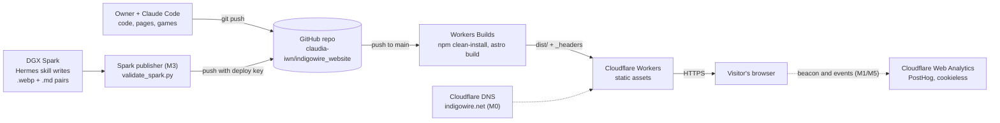

# indigowire.net Site Specification

Oct 25, 2026 · @Claudia

## 1. Overview

indigowire.net is a static Astro site on Cloudflare Workers that combines a one-person consultancy's basic pages with interactive networking games and a stream of AI images from a DGX Spark. It deploys automatically on every push to `main`.

**Owner:** Senior network engineer/architect and network automation consultant (sole operator).

### Goals

1. Present the consultancy simply: About, contact via LinkedIn, links to the Gratuitous ARP blog, LinkedIn and Bluesky.
2. Teach networking through interactive, unusual browser games, starting with an ARP simulator.
3. Publish Spark images ("what I'm working on", "something I saw", "how I feel right now") at any time of day with no manual web work.
4. Categorize all content (games, topics, images) with one shared tag system.
5. Cost nothing to host on the Cloudflare free tier.

### Non-goals (v1)

- No server-side code, database, login, comments or contact form.
- No CMS; content is files in the repo.
- No cookies, cookie banner or paid analytics; tracking stays cookieless (section 9).

### Using this spec with Claude Code

1. Export this doc as Markdown and save it in the repo as `docs/SPEC.md`.
2. Add a short `CLAUDE.md` at the repo root that points to `docs/SPEC.md` and states the conventions in section 3.
3. Work one milestone from section 10 at a time; ask Claude Code to tick tasks and update this spec when a decision changes.

## 2. Requirements

Each requirement has an ID that tasks, commits and tests can reference. Acceptance criteria use "when / then" form so Claude Code can turn them into tests.

| ID | Requirement | Acceptance criteria |
| --- | --- | --- |
| R1 | Site shell with persistent navigation | Every page shows header nav (Home, Learn, Spark, About, Speaking, Contact) and external links (Blog, LinkedIn, Bluesky, GitHub) that open in a new tab with `rel="noopener"`. Below 64rem the nav collapses into a menu button that opens it as a sheet across the top (section 11, "Mobile menu"). |
| R2 | About page | `/about` renders bio content from a Markdown file. |
| R3 | Contact page | `/contact` says to make contact through LinkedIn and links to the LinkedIn profile. No form. |
| R4 | Learn index | `/learn` shows the learning path (R17): every part, chapter and lesson in course order, with each lesson's status. Available lessons link to their page with title and one-line summary. |
| R5 | ARP simulator ("How IPv4 ARP works") | `/learn/arp` meets every acceptance criterion in section 6. |
| R6 | Spark gallery | `/spark` shows images newest first; filter by category (`working-on`, `saw-this`, `mood`) and tag. |
| R7 | Spark permalinks | Each image has `/spark/<slug>` with full image, caption, date, category, tags and alt text. |
| R8 | Spark publishing by push | When the glue code places a valid image + sidecar in the clone and the publisher pushes it to `main`, then the image is live after the build finishes, with no manual step. |
| R9 | Spark validation | When a sidecar is missing a required field, then the build fails, the previous version stays live, and the validation script reports the field. |
| R10 | Shared tags | `/topics/<tag>` lists all games, topics and images carrying that tag. |
| R11 | Home page | `/` shows a short intro, the latest Spark image, the course teaser and the external links. |
| R12 | Feeds | `/spark/rss.xml` lists the latest 50 Spark entries. |
| R13 | Auto deploy | When a commit lands on `main`, then Workers Builds builds and deploys it; other branches get preview deploys. |
| R14 | Custom 404 | Unknown routes return the site's 404 page with HTTP status 404. |
| R15 | Analytics | When a page loads, then Cloudflare Web Analytics records it; when a visitor does any action in the section 9 event table, then PostHog records that event with its properties; no cookies are set. |
| R16 | Speaking page | `/speaking`, titled "Workshops, Talks & Takes" (the nav label stays "Speaking"), lists talks, keynotes, podcasts, workshops, courses and Tech Field Day appearances from `src/content/speaking.yaml`, upcoming first, then past by type, newest first. Links only, no embedded players. |
| R17 | Learning path | The games and articles form one course, "How networking works", built around one question: what happens when I upload a photo to Leapix (a made-up photo site, `leapix.example`)? Part 0, "How devices talk", tells that story for adult beginners; Parts 1 to 7 go deeper in 34 numbered chapters, with IPv4 and IPv6 lessons side by side. Defined in `src/content/path.yaml`. Lessons that don't exist yet are listed as "Not available yet", one is marked "Up next", and each lesson page shows its place in the course (section 12). |

## 3. Architecture

Two writers feed one GitHub repo: the owner (code and pages, through Claude Code) and the Hermes skill on the DGX Spark (images). Every push to `main` triggers Workers Builds, which runs the Astro build and deploys the static output to Cloudflare Workers.



Dashed lines are planned, not live yet. A failed build deploys nothing, so the live site stays as it was until the next good push.

### Stack at a glance

Following one change from writing to reading:

1. **Writing.** The owner edits code and Markdown content with Claude Code. Images arrive from the DGX Spark, where the Hermes skill writes an image (`.webp`) and its sidecar (`.md`); the Spark publisher (M3) validates each pair and pushes it.
2. **Checking.** Locally, `npm run check` runs the linters (ESLint, Prettier, ruff), unit tests (Vitest for the games, pytest for the Python scripts), the build and the browser tests (Playwright). Content is checked again during the build by the collection schemas, so a bad file fails the build instead of publishing.
3. **Building.** Every push to `main` makes Cloudflare Workers Builds install the locked dependencies and run `astro build`, which turns the Astro pages, Markdown and images into plain HTML, CSS, a little JavaScript and resized images in `dist/`.
4. **Serving.** Cloudflare serves `dist/` as static files from its edge network, adding the security headers from `_headers`. There is no server code, database or login.
5. **In the browser.** Pages are mostly HTML and CSS. A few small scripts handle the theme, the text effects and the hero video; the ARP game page loads its own script. A strict Content Security Policy lets only the site's own scripts run.
6. **Measuring.** Lighthouse checks speed, accessibility, best practices and SEO (section 9, "About Lighthouse"). Cloudflare Web Analytics and PostHog will measure visits and game use once they are added (M1, M5).

### Tech stack and conventions

| Area | Choice | Notes |
| --- | --- | --- |
| Framework | Astro, static output | No adapter needed in v1; pages ship zero JavaScript unless they hold a game (small inline exceptions: N2). |
| Language | JavaScript (ES modules) with JSDoc type comments | Matches the owner's goal of learning JS; TypeScript can come later. |
| Styling | Plain CSS with custom properties (design tokens) | Light and dark themes from one token set: each color token is `light-dark(light, dark)`, chosen by `color-scheme`. No CSS framework. |
| Animation | None (no library) | The ARP simulator draws each frame from the engine's simulated clock (section 6, View), so Pause, Step, Speed and freeze-to-inspect need no animation timeline. GSAP was planned and dropped in M5 (October 2026), saving about 25 KB gzipped on the game page; add it back here first if a later game needs it. |
| Game rendering | Inline SVG | Clickable, crisp at any size, styled by the same tokens. |
| Content | Astro content collections, Markdown + YAML frontmatter | Schemas validated at build time. |
| Unit tests | Vitest | Required for game engines (pure logic). |
| Smoke tests | Playwright | Every route loads with status 200, no console errors and no horizontal scroll at 360 and 1280 px; also the 404 status, RSS feed, external-link attributes and theme toggle. Runs against `astro preview` of the build, in the installed Google Chrome (`channel: 'chrome'`), so no browser download. |
| Tooling | npm, Node LTS, Prettier, ESLint | `npm run check` runs lint (ESLint, Prettier, ruff), Vitest, pytest, the build and the Playwright smoke tests. Dev-only plugins: `prettier-plugin-astro`, `eslint-plugin-astro`, `@eslint/js`, `globals`. Prettier skips all Markdown so the spec and content keep their hand formatting. |
| Content scripts | Python 3 | `scripts/validate_spark.py` for Hermes; the owner's primary language. Managed with uv through pyproject.toml and uv run; tested with pytest, linted with ruff. |
| Hosting | Cloudflare Workers static assets + Workers Builds | Free tier; see section 8. |
| Analytics | Cloudflare Web Analytics + PostHog (cookieless) | Both free; see section 9. |
| Security | Content Security Policy from Astro (`security.csp`) + `public/_headers` | No extra package; see section 9, "Security" (N10). |
| Search | schema.org JSON-LD (`src/lib/seo.js`), `sitemap.xml`, `robots.txt`, `llms.txt` | No extra package; see section 9, "Search and AI search" (N11). |
| Performance and accessibility audits | Lighthouse 13.5.0, run with `npx` (not a project dependency) | `npm run lighthouse` (`scripts/lighthouse.mjs`); see section 9, "About Lighthouse". |
| Source control | GitHub, public repo `claudia-iwn/indigowire_website` | Workers Builds deploys `main`; see section 8. |
| DNS | Cloudflare DNS (moving from GoDaddy in M0) | See section 8, "Domain". |
| Image source | DGX Spark running the Hermes skill, plus the Spark publisher (Python under systemd, M3) | See section 7. |
| Python libraries | PyYAML and Pillow (the validator); pytest and ruff (dev); watchdog to come with the publisher (M3) | Managed by uv in `pyproject.toml`. |
| Media tools (owner's Mac only) | ffmpeg and cwebp for the hero video and stills (`scripts/make_hero_video.sh`); Playwright with the installed Chrome for the share cards (`npm run og`) | Not project dependencies; the outputs are committed. |

**Code conventions for Claude Code**

- Game logic lives in a DOM-free engine module; rendering subscribes to engine events. Never mix the two.
- Comment non-obvious JavaScript with a one-line Python comparison where it helps ("like a Python dict").
- No new runtime dependency without updating this table.
- **Example addresses come from the documentation ranges, never real or private ones.**
  - IPv4 uses RFC 5737 only: 192.0.2.0/24 (TEST-NET-1), 198.51.100.0/24 (TEST-NET-2) and 203.0.113.0/24 (TEST-NET-3).
  - IPv6 uses RFC 3849 only: 2001:db8::/32.
  - MAC addresses use RFC 7042 only: the documentation unicast range `00:00:5e:00:53:00`–`00:00:5e:00:53:ff`.
  - This applies to games, decrypt packets, tests, docs and blog examples. The ARP simulator's LAN is 192.0.2.0/24.
  - The `/learn` page has a section, "About the addresses in these games", with a table of these ranges, the RFC that reserves each one (linked) and what the site uses it for. Keep that table in step when a game starts using a new range.
  - **Made-up domain names** use the `.example` top-level domain, reserved for documentation by RFC 2606 and RFC 6761, so they can never be real sites: for example `leapix.example`, the course's photo site.
  - **One exception: 8.8.8.8.** It stands for "an address on the internet", because it is the address most network engineers recognize as one. Use it only in that role (the ARP simulator's off-subnet example), never as a stand-in for an ordinary host.

## 4. Repository structure and content model

All content is files under `src/content/`, validated by schemas in `src/content.config.js`; a bad file fails the build rather than publishing.

### Directory layout

```
indigowire_website/
├── CLAUDE.md                  # points Claude Code to docs/SPEC.md
├── docs/SPEC.md               # this document, exported as Markdown
├── astro.config.mjs
├── wrangler.jsonc
├── package.json
├── public/                    # logo.svg, logo-dark.svg, favicons, site.webmanifest, robots.txt
├── scripts/
│   ├── lighthouse.mjs         # N1/N3 run: `npm run lighthouse`, reports in lighthouse-reports/
│   ├── validate_spark.py      # checks one image + sidecar pair
│   └── spark_publisher.py     # watches the clone, commits and pushes
├── deploy/
│   └── spark-publisher.service  # systemd user unit for the DGX Spark
├── pyproject.toml             # uv: pillow, pyyaml, watchdog; dev: pytest, ruff
├── src/
│   ├── assets/brand/          # logo masters (.ai, .eps, .pdf) and exports
│   ├── content.config.js      # collection schemas
│   ├── content/
│   │   ├── tags.yaml          # shared tag list
│   │   ├── speaking.yaml      # talks, podcasts, workshops (R16)
│   │   ├── pages/             # about.md, home.md
│   │   ├── learn/             # one .md per game or topic
│   │   └── spark/YYYY/MM/     # <slug>.webp + <slug>.md pairs
│   ├── games/
│   │   └── arp/
│   │       ├── engine.js      # DOM-free simulation
│   │       ├── engine.test.js
│   │       ├── frames.js      # frame building + hex encoding
│   │       ├── renderer.js    # SVG view (DOM)
│   │       └── controller.js  # clock loop, Send form and playback controls (DOM)
│   ├── components/            # Header, Footer, TagList, SparkCard, SparkGrid, LearnList, BackHome, Decrypt
│   ├── layouts/BaseLayout.astro
│   ├── lib/content.js         # collection queries shared by routes (drafts filtered, sorting)
│   ├── pages/                 # routes (section 5)
│   ├── site.config.js         # site name and every external URL
│   └── styles/                # tokens.css (colors, type, spacing), global.css
└── tests/
    ├── test_validate_spark.py # pytest
    ├── fixtures/              # deliberately broken Spark entry
    └── smoke.spec.js          # Playwright; config in playwright.config.js
```

### Collection: `spark`

| Field | Type | Required | Rule |
| --- | --- | --- | --- |
| `title` | string | yes | ≤ 80 characters |
| `date` | ISO 8601 datetime with offset | yes | e.g. `2026-10-25T14:05:00-07:00`; `Z` is accepted, a space instead of `T` is not. Checked on the raw text, because YAML drops the offset when it parses the value |
| `category` | enum | yes | `working-on` \| `saw-this` \| `mood` |
| `image` | relative path | yes | Same basename as the `.md`, `.webp`; WebP, longest edge ≤ 2048 px, ≤ 25 MiB (over 1.5 MB is a warning) |
| `alt` | string | yes | Describes the image for screen readers |
| `caption` | string | no | ≤ 280 characters, Markdown allowed |
| `tags` | string\[\] | no | Lowercase kebab-case, from the shared tag list |
| `model` | string | no | Generator name, shown on the permalink |
| `draft` | boolean | no | `true` hides it from all listings |
| `prompt` | string | no | Shown on the permalink only when present; omit to keep a prompt private |

File names follow the glue-code contract (section 7): `YYYY-MM-DD-HHMM-<kebab-slug>`, in the matching `spark/YYYY/MM/` folder. The permalink slug is the file name without its folders.

Rules are enforced twice: by `validate_spark.py` before a push, and at build time by `src/content.config.js` (the Zod schema, plus the glob loader's `generateId`, which checks the image basename and the raw date). Keep the two in sync.

### Collection: `learn`

| Field | Type | Required | Rule |
| --- | --- | --- | --- |
| `title` | string | yes |  |
| `summary` | string | yes | One line, ≤ 140 characters |
| `category` | enum | yes | `layer-2` \| `layer-3` \| `automation` \| `security` (extend as needed) |
| `kind` | enum | yes | `game` \| `article` |
| `tags` | string\[\] | no | Shared tag list |
| `component` | string | games only | Name of the game module in `src/games/` |
| `description` | string | no | ≤ 200 characters. The search-result and link-preview description, when the one-line summary is too short; falls back to `summary` (N11) |
| `published` | date | no | First published (`YYYY-MM-DD`). Shown on the page and in structured data (N11) |
| `updated` | date | no | Last meaningful change (`YYYY-MM-DD`). Update it by hand when the page changes in substance, not for typo fixes; it feeds the sitemap's `lastmod` (N11) |

### Collection: `speaking`

One YAML list in `src/content/speaking.yaml`. Only confirmed engagements go in; `source` records where each was verified and is not shown on the page.

| Field | Type | Required | Rule |
| --- | --- | --- | --- |
| `id` | string | yes | Unique kebab-case key |
| `kind` | enum | yes | `keynote` \| `talk` \| `panel` \| `podcast` \| `workshop` \| `course` \| `delegate` |
| `date` | string | yes | `YYYY-MM-DD`, `YYYY-MM` or `YYYY`, as precise as is known; later than the build date means upcoming |
| `title`, `event` | string | yes | Exact session or episode title, and the event or show |
| `location`, `role` | string | no | City (or "Online"); role such as "Proctor" or "Opening keynote" |
| `url`, `video`, `code` | URL | no | Event or episode page, recording, companion repository |
| `source` | string | yes | Where the entry was confirmed |

### Shared tags

Tags are lowercase kebab-case (`arp`, `layer-2`, `ai-art`, `automation`). Keep the allowed list in `src/content/tags.yaml` with a display name per tag, so a typo fails validation instead of creating a new tag. The build reads the top-level keys of `tags.yaml` into the schemas' tag enum; the file is also loaded as a `tags` collection for display names.

## 5. Pages and routes

Every route is generated at build time; nothing renders on request.

| Route | Purpose | Content source | Req. |
| --- | --- | --- | --- |
| `/` | Intro, latest Spark image, the course teaser, external links | `pages/home.md`, newest `spark`, `getCourse()` | R11 |
| `/about` | Bio | `pages/about.md` | R2 |
| `/speaking` | Talks, podcasts, workshops, courses, Tech Field Day | `speaking` collection | R16 |
| `/contact` | "Contact me through LinkedIn" + link | Hard-coded component | R3 |
| `/learn` | The learning path: course map with "Start here", parts, chapters and lesson statuses, then the address ranges | `path.yaml` + `learn` collection | R4, R17 |
| `/learn/arp` | How IPv4 ARP works (the ARP simulator) | `learn/arp.md` + `src/games/arp/` | R5 |
| `/learn/<slug>` | Other games and articles | `learn` collection; entries with a `component` get their own page (`src/pages/learn/<component>.astro`) and are skipped here | R4 |
| `/spark` | Gallery, newest first, filters | `spark` collection | R6 |
| `/spark/<slug>` | Image permalink | `spark` entry | R7 |
| `/spark/category/<category>` | One category | `spark` collection | R6 |
| `/spark/rss.xml` | Feed of latest 50 | `spark` collection; hand-built XML endpoint, no RSS package | R12 |
| `/topics` | All tags with counts | `tags.yaml` + both collections | R10 |
| `/topics/<tag>` | Everything with that tag | Both collections | R10 |
| `/404` | Not-found page; `noindex`, no canonical | Hard-coded | R14 |
| `/sitemap.xml` | Every public page for search engines, with `lastmod` where content records a date | `src/lib/routes.js`; hand-built XML endpoint | N11 |
| `/robots.txt` | Crawler policy: search and AI search allowed, AI training refused; names the sitemap | `public/robots.txt` | N11 |
| `/llms.txt` | Plain-Markdown guide to the site for AI assistants (llmstxt.org format) | Built from the same collections as the pages | N11 |

**External links:** all URLs live in one config file, `src/site.config.js`. The header shows Blog, LinkedIn and Bluesky; the footer shows all of them.

| Link | URL | Where |
| --- | --- | --- |
| Gratuitous ARP blog | [gratuitous-arp.net](https://gratuitous-arp.net/) | Header, footer |
| LinkedIn | [linkedin.com/in/claudiadeluna](https://www.linkedin.com/in/claudiadeluna/) | Header, footer, `/contact` |
| Bluesky | [delunac.bsky.social](https://bsky.app/profile/delunac.bsky.social) | Header, footer |
| GitHub (Indigo Wire) | [github.com/claudia-iwn](https://github.com/claudia-iwn) | Footer |
| GitHub (personal) | [github.com/cldeluna](https://github.com/cldeluna) | Footer |

**Gallery filtering:** category pages are real routes so they work without JavaScript; tag filtering on `/spark` may add a small script that progressively enhances the grid.

## 6. Feature spec: ARP simulator

The page is titled **"How IPv4 ARP works"** (title in `src/content/learn/arp.md`; the URL stays `/learn/arp`). ARP is IPv4's address resolution; IPv6 uses Neighbor Discovery instead, which a later game could cover.

The visitor plays a host on a switched LAN: they send traffic, watch ARP resolve the address, and can freeze any frame to inspect its fields and bytes.

### Topology

One switch (SW1) and four ports in use; an attacker appears only in Break-it mode. MACs come from the RFC 7042 documentation range (`00:00:5e:00:53:xx`), with the last byte echoing the host's IP for easy matching.

| Node | Role | IP | MAC | Switch port |
| --- | --- | --- | --- | --- |
| H1 | Host (visitor's default) | 192.0.2.11/24 | 00:00:5e:00:53:11 | Gi0/1 |
| H2 | Host | 192.0.2.12/24 | 00:00:5e:00:53:12 | Gi0/2 |
| H3 | Host | 192.0.2.13/24 | 00:00:5e:00:53:13 | Gi0/3 |
| R1 | Default gateway | 192.0.2.1/24 | 00:00:5e:00:53:01 | Gi0/4 |
| M | Attacker (Break-it only) | 192.0.2.66/24 | 00:00:5e:00:53:66 | Gi0/5 |

**R1's upstream link.** R1's second interface is 198.51.100.1 (`00:00:5e:00:53:a1`). The next hop is 198.51.100.254 (`00:00:5e:00:53:fe`), and R1 already has it in its cache: the game does not simulate ARP on that link. Data frames carry an IP TTL of 64, and R1 lowers it by one.

**Users and infrastructure.** H1, H2 and H3 are user devices (laptops and desktops, where applications run). SW1 and R1 are network infrastructure. The view draws the two groups differently (shape, icon and a labelled legend) so a visitor can tell at a glance which boxes are people's computers and which are the network. The visitor's own host (H1 by default) is marked "You". Beyond R1, an upstream link leads off the diagram to a "next hop" (toward the internet), used for off-subnet traffic.

### Engine (`engine.js`, no DOM)

State:

- `hosts[name].arpCache`: map of IP → `{ mac, expiresAt }` (like a Python dict of dicts).
- `switch.macTable`: map of MAC → `{ port, expiresAt }`.
- `clock`: simulated milliseconds, advanced by the renderer, so tests run instantly.
- `log`: ordered list of events, each with a plain-English line.

Behavior (RFC 826 semantics):

1. `send(src, dstIp, app)`: an application on host `src` wants to reach `dstIp`. `app` names it and labels the data frame: `ping` (ICMP echo, the default), `web` (HTTP over TCP) or `dns` (DNS over UDP). The engine first logs **why ARP is needed**: the application knows only an IP address, but Ethernet delivers frames by MAC address, so the host must find the MAC to put in the frame. If `dstIp` is off-subnet, the host resolves its gateway's MAC instead, and the log says so. On a cache hit, emit a unicast data frame at once. On a miss, queue the data and emit an ARP request: Ethernet dst `ff:ff:ff:ff:ff:ff`, opcode 1, target MAC all zeros.
2. The switch learns the source MAC on the ingress port, floods broadcasts and unknown unicasts out every other port, and forwards known unicasts out one port.
3. Each receiving host whose IP is not the target drops the request. The target caches the sender's mapping, then sends a unicast reply (opcode 2).
4. The requester caches the reply and sends its queued data frame.
   - **The answer comes back** (decided October 2026, M6). The destination answers every request: a ping gets an ICMP echo reply, web an HTTP response, DNS an answer. The answer is sent like any packet, with ARP first if the sender lacks the next hop's MAC; after the exchange above, H2 already knows H1 from the request. Frames carry `reply: true`, and the view labels them "echo", "page" or "answer".
   - **Off-subnet answers** come back from the next hop to R1 with an IP TTL of 64 − `INTERNET_HOPS` (8, illustrative: the routers crossed on the internet). R1 rebuilds the frame for the LAN (new MACs, TTL one lower) and, if H1 is no longer in its cache, uses ARP for it first.
   - **Data frames are not decoded.** A data frame is an envelope labelled with its application (for example "ICMP echo request (ping)"). The inspector shows its Ethernet header (destination, source, EtherType `0x0800`) and its IP source and destination, but not the payload, which is not the point of the game.
   - **Off-subnet.** The data frame's Ethernet destination is R1's MAC, but its IP destination is still the far address (for example 8.8.8.8). R1 receives it, removes the Ethernet header, looks up its route and forwards the packet out its upstream link toward the next hop (`frame:forward`). The log and a caption spell out that the MAC address changes at each hop while the IP address stays the same end to end.
   - **No reply.** If nobody answers (for example 192.0.2.99), the request times out after 1 s of simulated time (`arp:timeout`). The view shows a speech bubble at the requester: "No reply. A real host typically retries about 3 times, a second apart, then reports the destination unreachable." The engine does not actually send the retries, so the visitor never waits. The queued data is dropped.
5. Cache and MAC-table entries expire after a TTL (default 60 s simulated, adjustable 10–300 s).
6. The engine emits events (`frame:emit`, `frame:arrive`, `frame:drop`, `frame:forward`, `cache:update`, `cache:expire`, `mactable:update`, `mactable:expire`, `arp:timeout`, `ip:conflict`, `host:down`, `log`) that the renderer subscribes to.
   - Every frame carries a `flow` number shared by everything one send causes (request, reply, data, the answer and R1's rebuilt frames), so the hop table can group them.
   - `frame:emit` from SW1 says `how` (`flood` or `forward`).
   - `frame:forward` carries R1's rebuilt frame as `out` (with `parent`), which then travels to the next hop like any other frame.

**Time and the API (built in M4).**

- **Simulated time.** Every hop (host to switch, or switch to host) takes `HOP_MS` (600 ms) of simulated time, slow enough to animate at 1× speed. The engine keeps a queue of timed actions. `tick(ms)` advances the clock and runs whatever falls due, in order, so tests run a whole exchange instantly.
- **Timeout start.** The `ARP_TIMEOUT_MS` (1 s) timer starts once a request has reached every host and none of them owns the address. Counting from the moment of sending wouldn't work: the slowed-down hops mean a real reply would arrive after the timer had already fired.
- **Cache rules (RFC 826).** A host refreshes an entry it already has from any ARP it sees, but adds a new entry only when it is the target, or when it receives a reply addressed to it. That is what makes gratuitous ARP refresh other caches, and what makes an unsolicited spoofed reply poison one.
- **Calls:**
  - `send(src, dstIp, app)`;
  - `announce(name)` for gratuitous ARP;
  - `claimIp(name, ip, why?)` for "Meanwhile, on another host…" and the failover (`why` is the log line);
  - `fail(name)` for the failover: the host's switch port goes down, SW1 forgets the MACs learnt there and sends it nothing, and the host sends nothing;
  - `primeCache(name, ip)` fills a cache entry from the topology, so a scenario starts from warm caches;
  - `spoof(attacker, victim, ip)` for Break it;
  - `setTtl(ms)`, clamped to 10–300 s;
  - `tick(ms)`, `runUntilIdle()` and `isIdle()`.
- **Inspector data.** `frames.js` has `encodeArpFrame(frame)` (60 bytes) and `arpFields(frame)`, the decode tree with each field's byte offset and length. Both read one field layout, so the hex dump and the tree always agree.

### Frame model (`frames.js`)

Every frame can be encoded to bytes for the inspector: Ethernet header (14 bytes: dst, src, EtherType `0x0806`) plus the 28-byte ARP payload (HTYPE 1, PTYPE `0x0800`, HLEN 6, PLEN 4, OPER, SHA, SPA, THA, TPA), padded to the 60-byte Ethernet minimum.

### Modes

| Mode | What the visitor does | What it teaches |
| --- | --- | --- |
| Learn | Guided steps with a caption per step; Next/Back | The request/reply exchange, step by step |
| Sandbox | Pick any source host, type any IP, press Send | Cache hits vs. misses, gateway resolution, aging |
| Gratuitous ARP | Make a host announce itself (sender IP = target IP, broadcast), as hosts do after getting an address from DHCP or coming up. Two scenarios, each starting with H1 and R1 already caching H2: **Failover** (H2 fails, and H3, its standby, takes over 192.0.2.12 and announces it; caches move to H3 with no alarm, and a ping to 192.0.2.12 is answered by H3) and **"Meanwhile, on another host…"** (someone on H3 mistypes a static IP as 192.0.2.12; H2 is still up, sees its own address claimed and reports a duplicate IP (`ip:conflict`), and the other caches flip to H3's MAC) | The legitimate uses first: cache refresh, failover of HA pairs, VRRP/HSRP and VM moves (listed under "Where you meet gratuitous ARP"); duplicate IP detection. A note says ARP has no authentication, a man-in-the-middle attack uses this same path, and Dynamic ARP Inspection defends against it (and blocks a failover pair whose port isn't trusted) |
| Break it | Enable attacker M, which sends unsolicited replies claiming 192.0.2.1 | Cache poisoning: victims' traffic to the gateway goes to M; a note names the defense (Dynamic ARP Inspection) |

**Mode switcher and Learn (decided October 2026, M6).**

- A radio group above the controls: Learn, Sandbox (the default), Gratuitous ARP. Switching mode resets the simulation. The URL hash names the mode (`#learn`, `#garp`), so a link opens straight into one.
- Each mode shows only its controls (`data-modes` on the element). Learn hides the Send form, Step and the TTL slider; Gratuitous ARP keeps the Send form, so a visitor can ping 192.0.2.12 after a scenario.
- **Learn** (`lesson.js`, DOM-free, tested): an introduction and 8 steps. H1 pings H2 with empty caches (why ARP, SW1 learns and floods, only H2 answers, the unicast reply, H1 sends the ping, H2's echo reply, the round trip done), then pings again with no ARP. Each step names the engine event it ends on. Next plays the clock until that event and pauses (finishing the current step first if it is still playing); Back rebuilds the lesson in a fresh engine and jumps to the step before. The engine is deterministic, so the rebuild is exact.
- **Step notes** (decided 27 October 2026): each step also has a short note (60 characters at most) tied to one device. When the step's event fires, the note appears on the diagram beside that device ("SW1 H1 is on Gi0/1. Broadcast: flood it"), replacing the last one. On wide screens it sits right of a host and below-right of the switch or router, clear of the hosts' links; on phones, below the device. A screen reader gets the same content from the caption's live region.
- Break it arrives with its own design pass; it is not in the switcher yet.

### View (`renderer.js`)

- SVG topology with labelled nodes and links; frames are small envelopes that travel along links. Each frame's position is computed every animation frame from the engine clock, `(clock − at) / (arrivesAt − at)` along its hop, so the picture can never drift from the simulation (no animation library).
- Broadcasts visibly fan out from the switch; dropped frames fade at the host with a short "not for me" label.
- **Colour by frame kind**, one token each (`--color-arp-request` purple, `--color-arp-reply` copper-red, `--color-ip-data` teal, `--color-eth` slate for Ethernet headers). The moving envelope, its packet view, its hop-table rows and the legend all use the same colour. Decided October 2026, after the ipcisco.com ARP lesson's diagrams.
- **Packet view** (`packet-view.js`), under the diagram and its tables. It shows the latest frame, or the one the visitor selects (which pins it and pauses).
  - **Frame strip:** Destination MAC, Source MAC and Type, then ARP (28 B) or IPv4 header (20 B) plus the payload, then Padding and FCS. Blocks are sized by byte count and tinted by layer.
  - **The inner header in 32-bit rows**, with a 0–31 bit ruler, the way RFCs draw it. For data frames, IPv4 fields the game doesn't model are shown greyed ("·").
  - **Field tree and hex dump**, folded under "Bytes". Hovering or focusing a field highlights it in the strip, the rows and the bytes.
  - Layouts come from `breakdown()` in `frames.js`, which is tested.
- **Hop by hop** (`hops.js`, tested): a table of every hop in the selected frame's exchange, with Eth dst, Eth src, IP src → dst, TTL and what the device did.
  - A flood is one row listing every port it went out of.
  - The switch rows say "unchanged".
  - R1's row highlights exactly what it rewrote: both MACs and the TTL.
- **R1's before/after card:** when R1 forwards a packet, a card beside it shows the old Ethernet addresses and TTL struck through, the new ones fading in, and the IP addresses unchanged. It is timed on the simulation clock (3 hops), so Pause and Step hold it. It sits above R1 on wide screens and to its right on phones, kept inside the diagram.
- Side panels: each host's ARP cache and the switch MAC table, updating live, with a countdown bar per entry. **Placement** (decided 27 October 2026, because stacked under the packet view a visitor missed the updates): the diagram and the panels share one wrapper (`.view`). From 72rem wide the panels sit in a 23rem column to the right of the diagram, and the wrapper grows past the page column, up to 90rem, so the diagram keeps its size. Narrower, they stack directly under the diagram, before the packet view.
- Event log beneath, also announced through an `aria-live` region.
- **Frame inspector:** clicking a moving frame pauses the timeline and opens a Wireshark-style decode (field tree) beside a hex dump; hovering a field highlights its bytes and vice versa.
- Controls: Play/Pause, Step, Speed (0.25×–2×), Reset, TTL slider, mode switcher.

### Acceptance criteria

- [x] Sending from H1 to 192.0.2.12 with an empty cache shows a broadcast request reaching H2, H3 and R1, drops at H3 and R1, a unicast reply to H1, then the data frame.
- [x] Sending again before the TTL expires skips ARP entirely.
- [x] Every send logs why ARP is needed (the app knows the IP; Ethernet needs the MAC) before any ARP frame.
- [x] Sending to 192.0.2.99 (unused) shows a request with no reply, an `arp:timeout` after 1 s simulated, and the "retries about 3 times" bubble and log line, without simulating the retries.
- [x] Sending to an off-subnet IP (e.g. 8.8.8.8) resolves R1's MAC, not the destination's; the data frame is addressed to R1's MAC with IP destination 8.8.8.8, and R1 forwards it toward the next hop.
- [x] "Meanwhile, on another host…" makes H3 claim 192.0.2.12: H2 reports a duplicate IP and the other hosts' caches map 192.0.2.12 to H3's MAC.
- [x] Failover: after H2 fails, H3 takes over 192.0.2.12 with no duplicate-IP alarm, H1's and R1's caches map it to H3's MAC, and a ping to 192.0.2.12 is answered by H3.
- [x] Every request is answered: H2's echo reply reaches H1 without a second ARP, and the answer from 8.8.8.8 comes back through R1, which rewrites both MACs and the TTL again.
- [x] Learn mode steps through the exchange with Next and Back, ending on a second ping that needs no ARP.
- [x] The switch MAC table learns H1 on Gi0/1 after the first frame.
- [x] The inspector's hex dump for a request is exactly 60 bytes and matches the decoded fields.
- [ ] Break-it mode shows H1's cache entry for 192.0.2.1 changing to M's MAC.
- [x] Everything works by keyboard; with `prefers-reduced-motion`, frames jump between nodes instead of gliding.
- [x] Engine unit tests cover every bullet above without a browser.
- [x] Usable at 360 px wide (panels stack under the topology).
- [x] User devices and infrastructure look different and a legend names both; the visitor's host is marked "You".
- [x] Frames are coloured by kind (ARP request, ARP reply, IP data) on the diagram, in the packet view, in the hop table and in the legend.
- [x] The packet view shows the frame strip, the inner header in 32-bit rows, and 60 linked bytes for an ARP frame.
- [x] For 8.8.8.8, the hop table shows SW1 forwarding unchanged and R1 rewriting both MACs and TTL 64 → 63, and R1's card shows the same change.

## 7. Feature spec: Spark image pipeline

Hermes's glue code drops an image and its sidecar into a local clone of the repo on the DGX Spark; a small publisher service there notices them, validates them, and commits and pushes so Workers Builds redeploys. The site has no upload API in v1.

### Glue code contract (already built in the Hermes skill)

1. **Convert** to WebP, longest edge ≤ 2048 px, target ≤ 1.5 MB (the Workers per-file limit is 25 MiB).
2. **Name** both files `<date>-<slug>`, e.g. `2026-10-25-1405-bgp-weather`: date and 24-hour time, then a kebab-case slug from the title.
3. **Write** into the clone at `src/content/spark/YYYY/MM/`: the `.webp` first, the `.md` sidecar last.
4. **Write atomically:** save each file under a temporary name (e.g. `.<name>.webp.tmp`) and rename it into place, so the publisher never sees a half-written file.
5. **Stop there.** No git commands; the publisher owns commit and push.

Example sidecar:

```markdown
---
title: BGP weather report
date: 2026-10-25T14:05:00-07:00
category: working-on
image: ./2026-10-25-1405-bgp-weather.webp
alt: A storm map where the isobars are drawn as AS paths between city routers
tags: [bgp, ai-art]
model: (generator name)
---
Debugging route flaps all afternoon.
```

### Spark publisher (`scripts/spark_publisher.py`)

A Python service on the DGX Spark, run with uv under systemd, that turns new files in the clone into one commit and push per batch. It decides what to publish from `git status`, not from file events, so it is safe to re-run and ignores files that arrive through `git pull`.

**Triggers**

- **Watch:** `watchdog` (inotify) watches `src/content/spark/` recursively. After the last change it waits a quiet period (default 30 s) before publishing, so several images made close together become one commit and one build.
- **Sweep:** a publish pass also runs at start-up and every 10 minutes, catching anything missed (a reboot, a failed push).
- **On demand:** `uv run scripts/spark_publisher.py --once` runs a single pass; the glue code may call it directly instead of relying on the watcher. `--dry-run` shows what would be committed.

**Publish pass**

1. Take a lock file so two passes never overlap.
2. List uncommitted files under `src/content/spark/` with `git status --porcelain`. Nothing new means exit.
3. Pair files by basename, ignoring dotfiles and `*.tmp`. Refuse symbolic links and anything outside `src/content/spark/`, so a link can't publish a file from elsewhere on the Spark. A pair is ready when both the `.webp` and `.md` exist and neither changed during the quiet period; incomplete pairs wait for the next pass.
4. Run `scripts/validate_spark.py` on each ready pair. An invalid pair stays in place, is logged with the validator's messages, and is skipped.
5. `git pull --rebase` on `main`.
6. `git add` only the valid pairs' paths, never `git add -A`, so stray edits in the clone are never published.
7. Commit: one image as `spark: <title>`; several as `spark: <n> images`, with the titles listed in the body.
8. Push over SSH with the repo's deploy key. On failure, retry after 1, 5 and 15 minutes; the sweep retries any commit still unpushed.
9. Log each permalink (`https://indigowire.net/spark/<name>`) to the journal, and post it to an optional notification webhook.

**Running it**

- `deploy/spark-publisher.service`: a systemd user unit that runs the publisher from the clone with `uv run`, restarts on failure, and starts at boot (needs `loginctl enable-linger` for the user).
- Settings in `spark_publisher.toml` beside the script: repo path, branch, quiet period, sweep interval, webhook URL.
- Logs: `journalctl --user -u spark-publisher -f`.

**Tests** (`tests/test_spark_publisher.py`, against a temporary repo with a local bare remote): a complete pair is committed and pushed; a lone `.webp` waits; an invalid pair is skipped while a valid one in the same batch is published; three pairs make one commit; a second pass with nothing new does nothing.

### Validation script (`scripts/validate_spark.py`)

- Python 3 with Pillow and PyYAML, run with uv, so it runs on the Spark without the Node toolchain. Hermes calls it as uv run scripts/validate\_spark.py.
- Checks every rule in the section 4 `spark` table, that the image exists, is WebP, and is within the size limits, and that each tag is in `tags.yaml`. It also checks the file name and `YYYY/MM/` location, and warns (without failing) about unknown fields and images over 1.5 MB.
- Accepts a sidecar, an image (its sidecar is found beside it) or a directory.
- Exit code 0 on success; non-zero with one line per problem.
- **Body safety:** the Markdown body is rendered as HTML, so it may not contain raw HTML (anything matching `<` followed by a letter, `!`, `/` or `?`) or `javascript:`, `vbscript:` or `data:` links. Plain Markdown, including ordinary links and text such as "< 5 ms", is fine.
- The same rules are enforced again by the Astro schema at build time (R9), so a skipped validation still cannot publish a broken entry.

### Build and gallery behavior

- Astro processes images into responsive sizes at build time; the gallery uses lazy loading and fixed aspect boxes to avoid layout shift.
- `draft: true` entries are built into no listing or route.
- Each permalink shows the image, caption, date in the viewer's locale, category, tags, model and (only when the sidecar has one) the prompt, with previous/next links. Each permalink is the image's own shareable page, and its Open Graph tags make it show as a preview card on Bluesky and LinkedIn.

### Capacity

- Each push is one build. Builds take about **40 seconds** (measured 26 October 2026), so a change is live within about a minute of a push, and the 3,000 free build minutes a month allow roughly 4,500 pushes.
- Spark publishing should still batch images (the publisher's quiet period) rather than push one image per commit. Only one build runs at a time (see Free-tier limits), so rapid pushes queue behind each other.
- If build time grows with the gallery, move originals to Cloudflare R2 and keep only the sidecars in git (deferred; not v1).

#### How the build time was measured and cut

Builds were taking 4 to 8 minutes. The fix came from reading the build log, not from guessing.

1. **Get the log.** In the Cloudflare dashboard, open Workers & Pages → `indigowire-website` → Deployments, then open a build to see its log. Every line has a timestamp. Workers Observability is not needed: it records runtime requests, not builds, and this site has no Worker script for it to log.
2. **Time each step.** Subtract the timestamps where one step starts and the next begins. Look for long gaps with no log lines.
3. **Find the cause and fix it, then compare the next build's log.**

| Step | Before (39120c5) | After (b96b5cd) |
| --- | --- | --- |
| Waiting for a build machine | 4 min 18 s | none this time |
| Setup, clone and cache restore | 6 s | 19 s |
| Installing Python 3.13.18 | about 2 min 45 s | skipped |
| `npm clean-install` (327 packages) | 5 s | 4 s |
| `uv sync` | 1 s | under 1 s |
| `astro build` | 3 s | 2 s |
| `wrangler deploy` (about 6 to 8 s is `npx` downloading Wrangler) | 15 s | 12 s |
| **Total** | **about 7 min 45 s** | **40 s** |

What the log showed and what was done about it:

- **Python was the cost.** The build image installed Python 3.13.18 because the repo had a `.python-version` file. That version isn't preinstalled, so it took almost 3 minutes, though the site build never uses Python.
  - The file was removed (b96b5cd). uv now takes the version from `requires-python` in `pyproject.toml`, locally and on the Spark. Cloudflare's build image uses its preinstalled Python (3.14.8) for its automatic `uv sync`, in under a second.
  - **Don't add `.python-version` back**, or every build will install Python again.
- **The queue is Cloudflare's.** The wait for a build machine is outside the repo's control, and it varies from build to build.
- **Not worth changing:**
  - Skipping npm dev dependencies would save about 2 seconds (checked by building a clean copy with `npm ci --omit=dev`, which also confirmed the build needs only Astro).
  - Adding Wrangler to `package.json` would save a few seconds, but it would add a dependency the spec doesn't list.
- **If builds slow down again,** repeat steps 1–3 with a fresh log.

## 8. Deployment

The site deploys as a Cloudflare Worker with static assets, built and deployed by Workers Builds on every push; no Worker script is needed in v1.

### `wrangler.jsonc`

```
{
  "name": "indigowire-website",
  "compatibility_date": "2026-10-25",
  "assets": {
    "directory": "./dist",
    "not_found_handling": "404-page"
  }
}
```

### Workers Builds settings

| Setting | Value |
| --- | --- |
| Repository | GitHub, `claudia-iwn/indigowire_website` (public) |
| Worker name | `indigowire-website`, matching `wrangler.jsonc`. Worker names allow only lowercase letters, digits and dashes, so it uses a dash where the repo name has an underscore |
| workers.dev URL | https://indigowire-website.claudia-b4a.workers.dev/ |
| Production branch | `main` |
| Build command | `npm run build` (runs `astro build`). Workers Builds runs `npm clean-install` first, and installs Python as well if it finds a `.python-version` file; see Capacity in section 7 |
| Deploy command | `npx wrangler deploy` |
| Non-production branches | Builds enabled, for preview URLs (R13) |

### Repository and access

The repo is public under `claudia-iwn`, because the games and the image pipeline double as a portfolio of the consultancy's automation work. Workers Builds works the same with a private repo, so this can change later without touching hosting.

- **No secrets in the repo.** Nothing in v1 needs one; any future token goes in Workers settings, never in files.
- **Hermes pushes with a deploy key** (SSH key with write access to this repo only), not a personal token, so a leaked key cannot touch any other repo.
- **Sidecars are public.** Prompts appear only when the sidecar includes a `prompt` field.
- **Licensing:** code under MIT (`LICENSE`); images and written content all rights reserved (`CONTENT-LICENSE.md`).

### Domain

`indigowire.net` is registered at GoDaddy. Moving DNS to Cloudflare is all the site needs; moving the registration is optional. The domain also carries email, so its mail records must survive the move.

**Step 1: move DNS (required, before M0 ends)**

1. In Cloudflare, add `indigowire.net` on the Free plan; Cloudflare scans and imports the existing records.
2. Compare the imported records with GoDaddy's DNS page line by line. Check MX, SPF (TXT), DKIM and DMARC records especially, and set mail-related records to DNS only (grey cloud).
3. If DNSSEC is on at GoDaddy, turn it off before changing nameservers (re-enable it in Cloudflare afterwards).
4. At GoDaddy, replace the nameservers with the two Cloudflare gives you. Propagation can take minutes to 24 hours.
5. Send and receive a test email, then attach `indigowire.net` as a Workers custom domain and redirect `www` to the apex. Cloudflare issues the HTTPS certificate automatically.
6. Turn on **Always Use HTTPS** (SSL/TLS → Edge Certificates), so every `http://` request gets a 301 to `https://`. The site's HSTS header can't do this alone: browsers ignore HSTS on an unencrypted response.

**As set up on 27 October 2026:** `indigowire.net` and `www.indigowire.net` are custom domains on the Worker. A Cloudflare redirect rule (the "Redirect from WWW to root" template: `https://www.*` → `https://${1}`, 301, query string kept) sends `www` to the apex; the rule editor warns that `www` may not be proxied, because it doesn't recognise the custom domain's DNS record, but the rule works (deployed with "Ignore"). Always Use HTTPS is on. Checked: `http://` and `http://www.` both end at `https://indigowire.net/…` in at most two 301s.

**Step 2: transfer the registration (optional, any time later)**

- Cloudflare Registrar charges cost price with no markup, and a transfer adds one year to the current expiry.
- Requirements: the domain is active on Cloudflare, it was registered or last transferred more than 60 days ago, and the registrant name, organization or email has not changed in the last 60 days.
- At GoDaddy, turn off Domain Privacy and Domain Protection (GoDaddy may reject the transfer otherwise), unlock the domain, and copy the authorization code into Cloudflare's transfer page. GoDaddy has up to five days to release it.

### Free-tier limits

| Limit | Workers Free | Impact |
| --- | --- | --- |
| Build minutes | 3,000 per month | \~4,500 pushes at the measured 40 seconds per build (section 7, Capacity) |
| Concurrent builds | 1 | Rapid pushes queue |
| Static asset files | 20,000 per version | Thousands of images |
| File size | 25 MiB | WebP images far below |
| Static asset requests | Free, unlimited | Traffic costs nothing |
| Worker script requests | 100,000 per day | Not used in v1 |

### Rollback

A failed build never replaces the live version. To roll back a bad deploy, revert the commit on `main` or pick an earlier version in the Cloudflare dashboard.

## 9. Non-functional requirements

The site should be fast, accessible and private by default, with targets Claude Code can check automatically.

**About Lighthouse.** Lighthouse is Google's free, open-source page auditor, built into Chrome's developer tools and run here from the command line (`npm run lighthouse`, or with `BASE_URL=…` against a deployed site). It loads each page in Chrome as a mid-range phone on a slow mobile connection and scores four categories from 0 to 100:

| Category | What it measures |
| --- | --- |
| Performance | How fast the page appears and becomes usable, from timings including LCP (when the largest element finishes drawing) and CLS (how much the layout shifts while loading; 0 is none) |
| Accessibility | Automated checks: colour contrast, alt text, labels, heading order, button names. It catches only part of WCAG, so N3 also needs a keyboard walk-through |
| Best practices | HTTPS, no console errors, no deprecated APIs, correctly sized images |
| SEO | Titles, descriptions, crawlable links, nothing blocking indexing |

`scripts/lighthouse.mjs` audits eleven pages, prints one row each, saves the full reports to `lighthouse-reports/` (not committed), and exits non-zero if Home, `/spark` or `/learn/arp` misses N1 or N3. Lighthouse sometimes fails to record a page load (`NO_NAVSTART`) and asks for a re-run, so the script retries a page up to three times before reporting the error.

Live run on workers.dev, 27 October 2026 (Lighthouse 13.5.0, mobile): every page 100 in accessibility, best practices and SEO; performance 100 everywhere except Home at 99; LCP 1.0 to 1.7 s; CLS 0 on every page.

| ID | Area | Target | How it is checked |
| --- | --- | --- | --- |
| N1 | Performance | Lighthouse Performance ≥ 95 on Home, `/spark` and `/learn/arp` (mobile) | `npm run lighthouse` (`scripts/lighthouse.mjs`) before each milestone closes; exits non-zero if N1 or N3 is missed |
| N2 | JavaScript budget | 0 KB of loaded scripts on content pages. Allowed inline exceptions: the theme and text-effects scripts on every page (N5): the `<head>` script that applies a saved choice before first paint (`src/lib/boot-script.js`, about 0.6 KB raw) and the header toggles (a bundled script that Astro prints inline because it is small, about 1 KB raw); together under 1 KB gzipped, and both hashed into the CSP (N10) and the locale-date script on Spark permalinks (section 7; UTC text is the no-JS fallback), and, as the one non-inline exception, the decorative "decrypt" script shared by Home, About and Speaking (`src/components/Decrypt.astro`; one cached file, about 2.5 KB gzipped, skipped with reduced motion or the header switch, no layout shift; section 9), the `/learn` part opener (inline, about 0.2 KB: when a link targets a chapter or part inside a folded part, it opens that part and scrolls to it; section 12, "`/learn`"), and the Home hero band script (`src/components/HeroBand.astro`; one cached file, about 1 KB gzipped; section 9, "Home hero band"). ≤ 150 KB gzipped on a game page | Build output size check |
| N3 | Accessibility | WCAG 2.2 AA; Lighthouse Accessibility = 100 | Lighthouse + keyboard walk-through |
| N4 | Motion | All animation respects `prefers-reduced-motion`; decorative text effects also have an on-site off switch (header) | Manual check with the OS setting on |
| N5 | Theming | Light and dark themes from `prefers-color-scheme`, plus a manual toggle in the header. A manual choice is stored in `localStorage` and applied by an inline `<head>` script before first paint; choosing the OS theme again clears it. Without JavaScript the toggle is hidden and the OS setting applies | Visual check in both themes; toggle, persistence and no-JS checked in headless Chrome |
| N6 | Responsive | Works from 360 px to 1920 px with no horizontal scroll | Playwright at 360 and 1280 widths (`tests/smoke.spec.js`, every route) |
| N7 | Privacy | No cookies or browser storage for tracking; the only third-party scripts are Cloudflare Web Analytics and PostHog in cookieless mode | Network tab shows only the site's origin, Cloudflare Web Analytics and PostHog; Application tab shows no cookies |
| N8 | SEO and sharing | Title, description and Open Graph image on every page; Spark permalinks use the image as the OG image | View source |
| N9 | Maintainability | `npm run check` passes before every merge | Workers Builds log / local run |
| N10 | Security | Every page carries a strict Content Security Policy (only the site's own, hashed scripts run, plus Cloudflare's Web Analytics beacon; nothing else loads from other sites) and the response headers in `public/_headers`; content written by the image pipeline can't inject markup or script links (section 9, "Security") | Playwright: CSP on every route, no violations while using the site, an injected script is blocked, and headers checked against the live site |
| N11 | Search and AI search | Every page has a unique title, a description of at least 70 characters, a canonical URL that matches the site's links, and schema.org structured data; a sitemap, `robots.txt` and `llms.txt` describe the site to search engines and AI assistants (section 9, "Search and AI search") | Playwright "Search and AI search (N11)" tests; Vitest `src/lib/seo.test.js`; Lighthouse SEO |

### Visual identity

The site uses the existing Indigo Wire Networks logo (2018): a circular wire mark beside an "INDIGO WIRE" wordmark with "NETWORKS" beneath. Its three colors become the core design tokens in `src/styles/tokens.css`.

| Token | Hex | From the logo | Use on the site |
| --- | --- | --- | --- |
| `--iw-navy` | `#233067` | "INDIGO" and half the mark | Text, headings, dark-theme background base |
| `--iw-indigo` | `#091F92` | "NETWORKS" and half the mark | Links, primary buttons, focus rings |
| `--iw-copper-dark` | `#6E1401` | Shadow of "WIRE" | Copper gradient start |
| `--iw-copper` | `#99482D` | Body of "WIRE" | Accents, active states, frames in the ARP game |
| `--iw-copper-light` | `#F6B88C` | Highlight of "WIRE" | Copper gradient end, dark-theme accent |

**Logo assets** are tracked in `src/assets/brand/`: `.ai`, `.eps`, `.pdf` (vector masters) and `.png`, `.jpg` exports. (The original `images/logos/logo-archive/` folder on the owner's computer is gitignored.) For the web:

- Convert the PDF master to an SVG for the header (`public/logo.svg`), plus a light version for the dark theme. Done with `pdftocairo -svg` (poppler), cropped to the artwork. `public/logo-dark.svg` recolors navy to `#FFFFFF` and indigo to `#B8C4FF`, keeping the copper gradient; the header shows the one matching the theme with the `.theme-light-only` / `.theme-dark-only` classes (both lazy-loaded, so the hidden one is not downloaded), which follow the manual toggle as well as the OS setting.
- Make a favicon and app icon from the circular mark alone. Done: `favicon.svg` holds only the mark's 60 dots and switches to the dark-logo colors under `prefers-color-scheme: dark`; `favicon.ico` (16/32/48) puts the mark on a white rounded tile so it shows on dark tab bars; `apple-touch-icon.png` (180) and `icon-192.png`/`icon-512.png` (in `site.webmanifest`) are on white. Rasters are rendered from the PDF master with `pdftocairo`.
- Check contrast: navy and indigo on white pass WCAG AA for text; copper is for accents and large text only, unless a contrast check shows it passes.

The tone stays technical and playful rather than corporate, with network-diagram motifs and copper "wire" lines as the recurring decoration.

### Decrypt effects

Decorative "decryption" of headings and text, in `src/components/Decrypt.astro`. A page opts in by rendering `<Decrypt />` and marking elements with data attributes:

| Attribute | On | Effect |
| --- | --- | --- |
| `data-decrypt="hex"` | A plain-text element | Each character starts as random hex (matching letter case) and resolves left to right when the element scrolls into view |
| `data-decrypt="mac"` | A plain-text element | The same, but the noise is a MAC address (`3f:a2:9c:…`) |
| `data-decrypt-ms="900"` | With `data-decrypt` | Duration for this element, overriding the default |
| `data-decrypt-hover` | With `data-decrypt` | Replays the effect on hover |
| `data-decrypt-links="hex"` | A container | Every plain link inside decrypts and replays on hover (for links written in Markdown, which can't carry attributes). Inside a packet paragraph the link only replays on hover, because the paragraph's own decrypt reveals it |
| `data-decrypt-packets` | A container | Each child `<p>` starts as a hex dump of a packet carrying its own text, then decrypts (below) |

**Where it is used:**

- **Home:** the title is hex (900 ms, replays on hover). The two intro paragraphs get the packet treatment described under About (IPv4/TCP, then IPv6/UDP). "How networking works" (the course teaser) and "Elsewhere" are MAC addresses, and "Latest from the Spark" is hex. The "More about me" link is hex and replays on hover.
- **About:** the title is hex (900 ms, replays on hover). Each paragraph starts as a Wireshark-style hex dump with a tcpdump-style summary line. The packet types rotate through IPv4/TCP, IPv6/UDP and ICMP echo request. The packets use documentation addresses (192.0.2.10, 198.51.100.7, 2001:db8::) and correct IPv4 and ICMP checksums, and each payload is the paragraph's own text, so the ASCII column shows it. One paragraph at a time, top to bottom, the dump turns into the paragraph in hex noise, which resolves left to right like the headings. Then there is a pause before the next paragraph.
- **Speaking:** the title "Workshops, Talks & Takes" is hex (900 ms, replays on hover).

**Editing the text.** The packet paragraphs come from Markdown: the Home intro from `src/content/pages/home.md` and the About text from `src/content/pages/about.md` (the body below the frontmatter). Edit them freely; nothing in the effect needs to change. The script reads each paragraph's text in the browser, so the payload, the length in the summary line, the checksums and the scrambled text always match what is on the page. Each paragraph (separated by a blank line) becomes one packet, and the packet types keep rotating if you add more. Only plain paragraphs get the effect; a heading or list in the Markdown appears normally. Links inside paragraphs work as usual. The Home and About titles are the `title` in each file's frontmatter; the Speaking title is in `src/pages/speaking.astro`.

**Tuning the timing.** All times are in milliseconds. Edit, then reload `npm run dev`; no other file needs to change.

| What | Where | Now |
| --- | --- | --- |
| Page titles (Home, About, Speaking) | `data-decrypt-ms` on each `<h1>` in `src/pages/index.astro`, `about.astro`, `speaking.astro` | 900 |
| Headings and links without `data-decrypt-ms` | `DEFAULT_MS` at the top of the script in `Decrypt.astro` | 650 |
| Hover replay | `HOVER_MS` in `Decrypt.astro` | 600 |
| Each packet paragraph's decrypt (Home intro, About) | `PARAGRAPH_MS` in `Decrypt.astro` | 1800 |
| Gap before the next packet paragraph starts | `PAUSE_MS` in `Decrypt.astro` | 1000 |
| Hold before the first paragraph decrypts (the packet stays up) | `FIRST_HOLD_MS` in `Decrypt.astro` | 750 |

To give one heading its own speed, add `data-decrypt-ms` to it. If you change these values, update the "Now" column.

**Rules:**

- **No layout shift and no change for assistive technology.** The real text never changes. The effect is drawn in an `aria-hidden` overlay on top, with the real text made transparent (headings and links) or covered (paragraphs), so screen readers always read the real text.
- **Turning it off.** It is skipped with `prefers-reduced-motion` and without JavaScript. Visitors can also turn it off with the `>_` switch beside the theme toggle (`#effects-toggle`, `aria-pressed`). Turning it off stores `effects=off` in `localStorage`, which the `<head>` script applies as `data-effects="off"` on `<html>` before first paint. Turning it off mid-animation uncovers the page at once. Turning it back on clears the stored choice and replays the effects. The switch is hidden when the OS already reduces motion.
- **Only plain text.** Headings and links that contain other elements are left alone. A link that wraps onto two lines is skipped.
- **Budget.** The script is one shared, cached file (about 5.3 KB, 2.5 KB gzipped), loaded only on pages that render `<Decrypt />` (N2).
- **Tests.** `tests/smoke.spec.js` ("decrypt effects") checks that About's paragraphs decrypt and are left unchanged (using Playwright's fake clock), that the switch works and is remembered, and that nothing animates with reduced motion.

### Home hero band

A full-width band at the top of Home shows a short "how indigo is made" video behind the page title. The light theme gets indigo dye bleeding into wet white linen; the dark theme gets indigo pigment swirling in a dark vat. Decided 26 October 2026.

**Files.** The source videos are the owner's 5-second, 24 fps clips (`web_background_light.mp4`, `web_background_dark.mp4`), kept outside the repo. From each one, ffmpeg (on the owner's Mac, not a project dependency) makes these files in `public/video/`:

| File | What |
| --- | --- |
| `home-hero-<theme>.webm` | VP9, 1280×720, no audio |
| `home-hero-<theme>.mp4` | H.264 fallback, 1280×720, no audio, `+faststart` |
| `home-hero-<theme>-first.webp` | First frame, shown while the video loads, so playback starts without a jump |
| `home-hero-<theme>-last.webp` | Last frame, where playback stops, and the still shown when motion is off |

`<theme>` is `light` or `dark`. Budget: about 1 MB or less per video and about 100 KB or less per still. The current files are 215 KB (light) and about 450 KB (dark) per video, and 41 to 57 KB per still.

**Remaking the files.** Run `scripts/make_hero_video.sh <light.mp4> <dark.mp4>`. It needs ffmpeg and cwebp (`brew install ffmpeg webp`) and overwrites the files in `public/video/`. The originals are kept outside the repo.

**Layout.**

- The band sits directly under the header, outside the content column. It spans the full width with no horizontal scroll at 360 px; `BaseLayout` has a named slot above `<main>` for it.
- Its height is `clamp(14rem, 45vh, 28rem)`. The video and stills fill it with `object-fit: cover`, cropping the frame to the band.
- `--hero-focus` in `HeroBand.astro` sets which part of the frame stays in view: `center 40%` for light, and `center 75%` for dark, which keeps the glowing pigment at the bottom of the vat in view.
- The page `<h1>` ("Indigo Wire Networks", from `home.md`) sits at the bottom left of the band, inside the content column's width, at `clamp(2.25rem, 6vw, 3.5rem)`. Its padding is on a wrapper, not the `<h1>`, so the decrypt overlay lines up with the text.
- A gradient from `--color-bg` at the bottom to transparent about halfway up blends the band into the page and gives the title near-solid colour behind it. The title must meet WCAG AA contrast against the stills in both themes.
- **Info button** (decided 27 October 2026): a quiet ⓘ icon at the bottom right of the band, level with the title (`--color-text-muted`, accent on hover and focus; accessible name "About the background video"). It opens a small card about the theme on screen (`theme-light-only` / `theme-dark-only`, so it follows the manual toggle too), each with one fact from history and its source:
  - **Light, dyeing with indigo:** white cotton goes into the vat, comes out yellow-green and turns blue as the indigo oxidizes. Fact: the oldest known indigo-dyed fabric is cotton about 6,000 years old from Huaca Prieta, Peru ([Splitstoser et al., Science Advances, 2016](https://doi.org/10.1126/sciadv.1501623)).
  - **Dark, making indigo:** leaves of the indigo plant soak and ferment until they release the dye; beating air in oxidizes it into indigo, which settles as a paste. Fact: Pliny the Elder described indigo, which reached Rome from India, as "a slime that adheres to the scum upon reeds" ([Natural History, book 35, section 46](https://www.attalus.org/pliny/hn35a.html)).

  Below both stories, in both themes, a note (decided 27 October 2026, the owner's wording) says the background was inspired by the owner's visit to the exhibition "An Ocean in a Drop" at the Indigo Art Museum in Ahmedabad, Gujarat, India, the world's first institution solely dedicated to indigo, near the Kasturbhai Lalbhai Museum campus in Shahibaug. It links the [museum's website](https://www.indigoartmuseum.org/) only; its Exhibitions page (`exhibitions.html`) was dropped because it didn't render for the owner. Checked on the museum's site the same day: the "world's first" wording, the exhibition (21 February to 30 April 2026, from its artist-in-residence programme) and the address (Lalbaug, Shahibaug, Ahmedabad 380004); listings place it on the Kasturbhai Lalbhai Museum campus.

  The card is a native `popover`, so it needs no JavaScript (N2) and closes with Esc, a click outside or its Close button. It scrolls if the screen is too short for it. Any new fact needs a source a reader can check.

  **Sources checked** (27 October 2026). The card links only the primary source for each fact; the rest are recorded here so the facts can be re-checked.

  | Fact | Source | What it confirms |
  | --- | --- | --- |
  | Oldest indigo-dyed fabric | Splitstoser et al., "Early pre-Hispanic use of indigo blue in Peru", *Science Advances*, 14 September 2016 ([doi.org/10.1126/sciadv.1501623](https://doi.org/10.1126/sciadv.1501623), which redirects to [science.org](https://www.science.org/doi/10.1126/sciadv.1501623); linked from the card) | The primary source: blue pigment on cotton fabric from Huaca Prieta, Peru, identified as indigo (indigotin), about 6,000 years old, the earliest known use of indigo. science.org refuses automated readers, so these details were confirmed through the coverage below and search results, not the article page itself |
  | | ScienceDaily, "Researchers identify oldest textile dyed indigo, reflecting scientific knowledge from 6,200 years ago", September 2016 ([sciencedaily.com](https://www.sciencedaily.com/releases/2016/09/160914150426.htm)) | The press release, citing the same DOI: "the oldest known textile decorated with indigo blue", from Huaca Prieta. It rounds the age to 6,200 years; the card uses the paper's "about 6,000" |
  | | GW Today, "GW Researcher Identifies Oldest Textile Dyed Indigo" ([gwtoday.gwu.edu](https://gwtoday.gwu.edu/gw-researcher-identifies-oldest-textile-dyed-indigo)) | George Washington University on its lead author, Jeffrey Splitstoser: the fabric is cotton (*Gossypium barbadense*), excavated at Huaca Prieta on Peru's north coast in 2009 |
  | Pliny on indigo | Pliny the Elder, *Natural History*, book 35, section 46, translated by H. Rackham (1952), at [attalus.org](https://www.attalus.org/pliny/hn35a.html) (linked from the card) | The quote, word for word: indigo is "a product of India, being a slime that adheres to the scum upon reeds". The same passage gives its price as 20 denarii a pound |

  The process text (fermenting the leaves releases the dye; air oxidizes it into indigo; cloth leaves the vat yellow-green and turns blue in air) is standard dye chemistry and carries no link. "Indigo plant" rather than "tree": *Indigofera tinctoria* is usually a shrub.
- The title keeps its decrypt effect and hover replay. Everything below the band (intro packets, the course teaser, latest image, Elsewhere) is unchanged.

**Behaviour.**

- **Plays once, then holds.** The first-frame still shows at once. The video starts downloading only after the page's `load` event, so it doesn't affect LCP. It plays once (no `loop`, `muted`, `playsinline`) and stays on its last frame, so no pause control is needed under WCAG 2.2.2.
- **Replay.** Hovering over the band with a mouse replays it, but not while it is already playing.
- **Theme toggle.** The band shows the current theme's last-frame still, without replaying.
- **Motion off.** With `prefers-reduced-motion`, the `>_` effects switch off (`data-effects="off"`), or the browser's data saver on (`navigator.connection.saveData`), no video is downloaded and the last-frame still shows. Turning the switch off during playback jumps to the still; turning it back on replays the video.
- **No JavaScript.** The last-frame still shows.
- **Decoration only.** The video and stills are `aria-hidden` with empty `alt`. The title stays a real `<h1>`.

**Code.**

- `src/components/HeroBand.astro` holds the markup, styles and script. Only `src/pages/index.astro` uses it.
- The stills are CSS backgrounds chosen by theme and state, so only the one shown is downloaded.
- `<main>` is full width. The page column is `.page-body` inside it, below `BaseLayout`'s `hero` slot.
- The script is one cached file, about 1 KB gzipped (N2). No new dependencies.

**Tests.** Playwright checks four things:

- The band and title show.
- The video plays and ends on its last frame.
- With reduced motion or the switch off, no video is requested.
- There is no horizontal scroll at 360 px.

Lighthouse on Home must still meet N1 and N3.

Measured 26 October 2026:

- **Lighthouse:** Home scored 100 in every category, with LCP 1.5 s and CLS 0. Live on workers.dev, 27 October 2026: 99 performance and 100 in the rest, with LCP 1.7 s and CLS 0.
- **The still is Home's LCP element.** Lighthouse names `div.hero-band > div.media > div.still` as the largest thing drawn during load (the first-frame still, since the video only starts after `load`), so it sets Home's speed score. Of the live 1.7 s, about 0.57 s was waiting for the server's first byte, 0.11 s before the browser found the image (it is a CSS background, found only once the stylesheet is read), and 0.06 s downloading it.
- **Optional speed-up, not done:** a `<link rel="preload" as="image">` for the current theme's first-frame still would let the browser fetch it straight away. Lighthouse's "add fetchpriority=high" hint can't apply to a CSS background. Home already clears N1, so this is only worth doing if it drops below 95.
- **Title contrast:** the worst single background pixel behind the title gave 5.6:1 (light theme at 360 px), against AA's 3:1 for large text. Recheck it if the clips change.

### Share cards (Open Graph, N8)

Decided October 2026, M6. A link to any page shows a preview card on Bluesky, LinkedIn, Slack and the like.

- **Tags on every page** (`BaseLayout`): `og:title`, `og:description`, `og:url`, `og:type`, `og:site_name`, `og:image` with its `width`, `height` and `alt`, and `twitter:card` = `summary_large_image`. Image URLs are absolute on `site.url` (`https://indigowire.net`).
- **Which image:** Spark permalinks share their own image, as a 1200 px JPEG from `getImage` (LinkedIn does not reliably take WebP). Every other page uses one of four cards, listed with their alt text in `shareCards` in `src/site.config.js`:

| Card | Used by | Picture |
| --- | --- | --- |
| `default` | Home, About, Speaking, Contact, Topics, 404 | The light hero still (dye on wet linen) |
| `learn` | `/learn` and Learn articles | A snapshot of the ARP simulator mid-broadcast |
| `arp` | `/learn/arp` | The same snapshot, titled "How IPv4 ARP works" |
| `spark` | `/spark` and its category pages | The dark hero still (pigment in a vat). Not a mosaic of Spark images, which would go stale with every new image |

- **How they are made:** `npm run og` builds the site and runs `scripts/make_og_images.mjs`. It draws each card as an HTML page from the tokens and logo (logo, title, one line, `indigowire.net`, the copper bar) and photographs it in Chrome with Playwright at 1200 × 630, as a JPEG of about 60–90 KB in `public/og/`. The cards are committed, like the hero video. Re-run it when a card's title, the logo, the hero stills or the simulator's look change. No new dependency.
- **Test:** a Playwright smoke test checks every route has the tags and that its image loads as a JPEG at least 1200 px wide.
- **Until the domain moves** (M0), `indigowire.net` does not serve this site, so previews of `workers.dev` links show no image.

### Analytics

Three free layers, all cookieless, so the site needs no consent banner: Cloudflare's built-in metrics, Cloudflare Web Analytics for traffic and speed, and PostHog for what visitors do inside the games and gallery.

| Layer | What it measures | Free limit | Setup |
| --- | --- | --- | --- |
| Cloudflare zone and Workers metrics | Requests, bandwidth, status codes, threats at the edge | Included | Automatic once DNS is on Cloudflare |
| Cloudflare Web Analytics | Visits, page views, page load time, Core Web Vitals (LCP, INP, CLS) with the slowest elements named | No traffic cap | One beacon script in `BaseLayout` |
| PostHog (cookieless mode) | Custom events, funnels, trends, autocaptured clicks, unique visitors per day | 1M events/month, 1-year retention | `posthog-js` with `cookieless_mode: "always"` |

**PostHog events** (names in `snake_case`, defined once in `src/analytics.js`):

| Event | Fired when | Properties |
| --- | --- | --- |
| `outbound_click` | A blog, LinkedIn, Bluesky or GitHub link is clicked | `target` |
| `arp_send` | Send is pressed in the ARP game | `mode`, `cache_hit`, `off_subnet` |
| `arp_mode_change` | The ARP mode switches | `from`, `to` |
| `arp_inspector_open` | A frame is opened in the inspector | `frame_type` |
| `arp_learn_complete` | The last guided step is reached | `seconds` |
| `spark_filter` | A gallery category or tag filter is used | `category`, `tag` |

**CSP (N10):** adding a script means adding its hosts to the CSP in `astro.config.mjs` (`script-src` and `connect-src`), and the Playwright CSP tests fail until that is done.

**Cloudflare Web Analytics uses automatic setup** (decided 27 October 2026). On a zone proxied through Cloudflare, the dashboard offers only automatic setup ("This hostname belongs to an existing website on your account. Deploy with automatic setup."), so Cloudflare injects the beacon into every HTML page as it is served; there is no snippet in `BaseLayout` and no token in the repo. The beacon is a fixed file with an integrity hash from `https://static.cloudflareinsights.com`, which is the one outside host in `script-src`; it reports to `/cdn-cgi/rum` on the site itself, so `connect-src` stays `'self'`. The workers.dev copy gets no beacon.

**Bot Fight Mode stays off** (turned off by the owner, 27 October 2026). It forces Cloudflare's JavaScript Detections on, which injects an inline script whose content changes on every request (`window.__CF$cv$params`). A hash-based CSP can't allow it, and Cloudflare supports it only with per-request nonces in a CSP response header, which static files can't produce; the alternative, `'unsafe-inline'`, would let any inline script run. For a static site with no logins or forms, the bot protection buys little, and Cloudflare's DDoS protection stays on regardless. If a future plan needs bot protection, it needs a Worker that adds nonces.

**JavaScript Detections can't be switched off on the free plan** (checked 27 October 2026). Turning Bot Fight Mode off did not stop the injection on `indigowire.net` or `www.indigowire.net`; Cloudflare's documentation says detections can't be disabled for Bot Fight Mode customers, and community reports of an API workaround (`enable_js: false`) are mixed. So the CSP keeps blocking the script, which is harmless with bot protection off: the fingerprinting simply doesn't run, and visitors see no difference, only one console error per page. `'report-sample'` in `script-src` puts the first 40 characters of any blocked script in the violation report, and the Playwright tests forgive only a blocked inline script that starts like Cloudflare's snippet (`CLOUDFLARE_JSD` in `tests/smoke.spec.js`); any other blocked script still fails them. If Cloudflare later lets the free plan turn detections off, delete that exception.

**Trade-offs of cookieless mode:** no session replay, no visitor country in PostHog (Cloudflare Web Analytics still shows countries), and returning visitors look new each day. Ad blockers may block PostHog; routing it through a small Worker on `indigowire.net` is a later option that would count against the 100,000 daily Worker requests.

### Search and AI search (N11)

Designed 27 October 2026. The goal is to be found and described correctly by traditional search (Google, Bing) and by AI assistants that search the web and cite pages (ChatGPT search, Claude, Perplexity, Google's AI features). The two overlap: Bing's index also feeds ChatGPT search and Copilot, and Google's AI features use Google's index. Both reward the same things: pages that are fast and readable without JavaScript, one clear URL per page, accurate descriptions, and structured data saying who wrote what.

**Canonical URLs.** The build writes `about.html`, but the site links to `/about`, so every page's `<link rel="canonical">` and `og:url` are the link form (`canonicalPath` in `src/lib/seo.js`). Before 27 October 2026 they ended in `.html`, which would have split each page across two addresses.

**Titles and descriptions.** Every page has a unique `<title>` and a `<meta name="description">` of at least 70 characters that says what the page is in plain words. Learn entries can set a longer `description` than their one-line `summary`. Pages also carry `<meta name="author">` and `og:locale`; Spark permalinks are `og:type` `article` with `article:published_time`.

**Structured data** (schema.org JSON-LD, one `@graph` per page, built by `src/lib/seo.js` and printed by `BaseLayout`):

| On | Nodes |
| --- | --- |
| Every page | `WebSite`, `Organization` (Indigo Wire Networks, founded 2008, founder Claudia de Luna), `Person` (Claudia de Luna: job title, San Francisco Bay Area, Stanford, NASA Exceptional Achievement Medal, Cisco Certified DevNet Associate, Network Automation Forum, areas of expertise, and every profile in `site.config.js` as `sameAs`), and a `WebPage` of the right kind (`ProfilePage` for About, `ContactPage`, `CollectionPage` for listings) |
| Inner pages | `BreadcrumbList` from Home down |
| `/learn/arp` and other Learn entries | `LearningResource`: free, interactive, beginner, author, dates, keywords |
| Spark permalinks | `ImageObject`: creator and copyright holder Claudia de Luna, credit text, licence (`CONTENT-LICENSE.md`), date, and the AI model as contributor |
| `/speaking` | `ItemList` of `Event`s (talks, keynotes, panels, workshops, courses, Tech Field Day) and `PodcastEpisode`s |

Every fact about the person and the company comes from the About page; add nothing that the site doesn't say. The JSON is printed with `<` escaped as `\u003c`, so content can't close the script element, and the CSP doesn't apply to it because it is data, not code. The 404 page has none, and `noindex`.

**Sitemap, robots.txt and llms.txt.**

- `/sitemap.xml` lists every public page (`src/lib/routes.js`): the fixed pages, every Learn entry and Spark image, the Spark categories, and each topic that has at least one entry (an empty topic page is thin content). `lastmod` appears only where the content records a real date: a Spark image's date, a Learn entry's `updated` or `published`. No 404, no drafts.
- `/robots.txt` allows everything for ordinary crawlers and AI search, refuses AI training, and names the sitemap. Decided 27 October 2026 by the owner: allow search, block training, because the content is all rights reserved.

  | Allowed (search and answers that cite the page) | Refused (model training) |
  | --- | --- |
  | Every crawler by default (`*`, which covers Googlebot and Bingbot), plus `OAI-SearchBot`, `ChatGPT-User` (OpenAI), `Claude-SearchBot`, `Claude-User` (Anthropic), `PerplexityBot`, `Perplexity-User` | `GPTBot` (OpenAI), `ClaudeBot` (Anthropic), `Google-Extended` (Gemini training and grounding in Gemini Apps; no effect on Google Search or its AI features), `Applebot-Extended`, `CCBot` (Common Crawl), `Meta-ExternalAgent`, `Bytespider` |

  robots.txt is a request: reputable crawlers honour it, and OpenAI and Perplexity say their user-triggered fetchers may not. Check the vendors' crawler pages once a year; names change.
- `/llms.txt` follows the llmstxt.org proposal: the site name, a one-line summary, a paragraph about the company, then links with one-line notes (About, Speaking, Contact, every Learn entry, the ten newest Spark images, the external profiles, the feed and sitemap). It is built from the collections, so it stays current.

**One address.** The workers.dev copy sends `X-Robots-Tag: noindex` (a host rule in `public/_headers`), so only `indigowire.net` is indexed once the domain moves. Until then the site stays out of search on purpose. Side effect: Lighthouse's SEO score on workers.dev drops (it flags the `noindex`); measure SEO on `indigowire.net` after the move.

**Content readable without JavaScript.** The ARP page prints the Learn lesson's nine steps as text ("How ARP works, step by step", folded under "Read the lesson as text"), from the same `LESSON` data as Learn mode. That doubled its readable text to about 700 words; crawlers and AI assistants mostly don't run the game.

**Tests:** `src/lib/seo.test.js` (canonical paths, JSON-LD escaping and each node's fields) and the Playwright "Search and AI search (N11)" group: unique titles and descriptions of at least 70 characters, canonical equals `og:url` equals the link, one valid JSON-LD graph per page with the right types, the 404 page's `noindex`, every sitemap URL loading, the robots.txt groups, `llms.txt`, the lesson text without JavaScript, and (live only) the workers.dev `noindex` header.

**Owner actions after the domain move** (M0):

- [x] Verify `indigowire.net` in Google Search Console. Done 27 October 2026 as a Domain property (covers http, https and www), verified by a TXT record Google added through Cloudflare; keep that record. Still to do: submit `https://indigowire.net/sitemap.xml` under Sitemaps
- [ ] Do the same in Bing Webmaster Tools, which can import the Search Console setup. Bing's index feeds ChatGPT search and Copilot.
- [ ] Run Lighthouse against `indigowire.net` and confirm SEO 100.
- [ ] Link back to `https://indigowire.net` from the LinkedIn, Bluesky and GitHub profiles, so the `sameAs` links point both ways.
- [ ] Replace or mark `draft: true` the three sample Spark entries (placeholders) before the site is indexed, or they will appear in search and in `llms.txt`.

### Security (N10)

Audited 27 October 2026. The site is static files on Cloudflare: no server code, no forms, no logins, no cookies, no database, so there is nothing to break into on the site itself. The realistic risks are someone else's markup or script reaching a page, the site being framed by another site, and someone abusing the accounts and keys that can change it.

**Controls in the site**

- **Content Security Policy**, a `<meta>` tag on every page, built by Astro (`security.csp` in `astro.config.mjs`). Only scripts and styles whose SHA-256 hash is in the policy run, and nothing loads from another site except Cloudflare's Web Analytics beacon (`https://static.cloudflareinsights.com` in `script-src`; section 9, "Analytics") (`default-src 'self'`, `object-src 'none'`, `base-uri 'self'`, `form-action 'self'`). There is no `'unsafe-inline'` or `'unsafe-eval'`.
  - Astro hashes its own scripts and styles. The one hand-written inline script, the theme script in `<head>`, lives in `src/lib/boot-script.js`; the page prints that string and the config hashes the same string, so the hash can't go stale.
  - Style changes made from JavaScript go through `el.style`, never a `style=""` attribute, which the policy blocks.
  - Markdown syntax highlighting is off, because Shiki uses inline styles.
- **Response headers** in `public/_headers` (Workers reads the file and never serves it): `frame-ancestors 'none'` and `X-Frame-Options: DENY` (no clickjacking), `X-Content-Type-Options: nosniff`, `Referrer-Policy: strict-origin-when-cross-origin`, a `Permissions-Policy` that turns off camera, microphone, location and other device APIs, `Cross-Origin-Opener-Policy: same-origin`, and `Strict-Transport-Security: max-age=31536000` (without `includeSubDomains` until every subdomain is known to have HTTPS).
- **No HTML from content.** Pages print content as text (Astro escapes it); no `set:html` with content and no `innerHTML` anywhere. Spark bodies are refused if they contain raw HTML or script-capable links (section 7, "Body safety"), checked by both the validator and the build. The RSS feed escapes every field.
- **External links** open with `rel="noopener"`.
- **Stored settings** (`theme`, `effects` in `localStorage`) are only compared with fixed values, never written into the page.
- **Dependencies:** one runtime dependency (Astro); `npm audit` reported 0 vulnerabilities on 27 October 2026. Workers Builds installs with `npm clean-install` from the committed lockfile. YAML is read with `yaml.safe_load`.
- **Secrets:** none in the repo or its history (scanned 27 October 2026); `.env*` is ignored.

**Tests** (`tests/smoke.spec.js`, "Content Security Policy"): every route has the strict policy; using the home info card, the simulator and a Spark permalink causes no violation; an injected inline script does not run; and, against the live site only, the `_headers` headers are present. `tests/test_validate_spark.py` covers the body rules.

**Owner actions, outside the code** (not done in the audit, because they change GitHub, Cloudflare or DNS settings):

- [ ] Two-factor authentication on the GitHub, Cloudflare and GoDaddy accounts.
- [ ] GitHub: turn on Dependabot alerts and secret scanning (free for public repos), and a branch rule on `main` that blocks force pushes and deletion.
- [ ] Hermes deploy key (M0): it can write anything in the repo, not just `src/content/spark/`, so a compromised Spark could change the whole site. Before M3, decide between accepting that (the body rules and the CSP limit what a bad sidecar can do) and having Hermes push to a separate branch that a check merges only when every change is a valid pair under `src/content/spark/`.
- [ ] DNSSEC: turn it on in Cloudflare (DNS → Settings → DNSSEC) and add the DS record it gives at GoDaddy, the registrar. Not on as of 27 October 2026.
- [ ] CAA records naming the certificate authorities Cloudflare uses. None as of 27 October 2026.
- [ ] Email authentication (in progress), so no one can send convincing mail as `@indigowire.net`. Found on 27 October 2026: mail is Microsoft 365 (MX `indigowire-net.mail.protection.outlook.com`); SPF is `v=spf1 include:secureserver.net -all`, whose GoDaddy chain includes `spf.protection.outlook.com`, so Microsoft 365 mail passes SPF; DKIM isn't set up for the domain (no `selector1`/`selector2._domainkey` records), so Microsoft 365 signs with its `onmicrosoft.com` domain, which doesn't count for DMARC; there is no DMARC record. Plan, in order:
  - [x] **DMARC, monitoring only:** TXT `_dmarc` = `v=DMARC1; p=none; rua=mailto:…@dmarc-reports.cloudflare.net`. Done 27 October 2026 with Cloudflare's DMARC Management (Email → DMARC Management), which collects the daily reports in a dashboard. Changes nothing about delivery.
  - [x] **DKIM in Microsoft 365:** done 27 October 2026. CNAMEs `selector1._domainkey` and `selector2._domainkey` → `selector1-indigowire-net._domainkey.NETORGFT4286245.onmicrosoft.com` (and `selector2-…`), DNS only in Cloudflare, enabled at `security.microsoft.com/dkimv2` (signing in with the Microsoft 365 address; GoDaddy's login doesn't work there). A test message showed `spf=pass`, `dkim=pass header.i=indigowire.net` (`s=selector1`) and `dmarc=pass`.
  - [ ] **DKIM keys to 2048 bits:** Microsoft created 1024-bit keys (Cloudflare's email security check warns about them). At `security.microsoft.com/dkimv2`, select `indigowire.net` → Rotate DKIM keys, or in Exchange Online PowerShell `Rotate-DkimSigningConfig -Identity indigowire.net -KeySize 2048`. No DNS change: the CNAMEs point at Microsoft. The switch takes a few days.
  - [ ] **Tighten DMARC** from about 10 November 2026, after two to four weeks of reports in Cloudflare's DMARC Management showing only Microsoft 365 sending as `@indigowire.net`, and passing: `p=quarantine`, then `p=reject` (same record, `rua` kept).
  - [ ] **Optional, SPF:** `include:secureserver.net` authorises all of GoDaddy's shared mail servers. Once the reports show Microsoft 365 is the only legitimate sender (no old website forms or newsletter services), change SPF to `v=spf1 include:spf.protection.outlook.com -all`.
  - [ ] **Optional, BIMI** (the logo shown beside the site's mail in supporting inboxes): only after DMARC is at `p=quarantine` or `p=reject`. Needs the logo as an SVG Tiny PS file and, for Gmail and Apple Mail, a paid Verified or Common Mark Certificate. Branding, not security.
- [ ] After the domain move, check the live headers again (`BASE_URL=https://indigowire.net npm run test:e2e`).

## 10. Implementation plan

Seven milestones, each ending in a deployed, working site; hand Claude Code one milestone at a time and have it tick tasks here as they land.

### M0: Repo and deploy skeleton

- [x] Add `indigowire.net` to Cloudflare, verify imported records (mail records especially), switch GoDaddy nameservers, confirm email still works (section 8, step 1). Done 27 October 2026: nameservers are Cloudflare's, and the owner confirmed email works
- [x] Create the public repo `claudia-iwn/indigowire_website` with `LICENSE` (MIT) and `CONTENT-LICENSE.md`
- [x] Initialize an Astro project (static output, JavaScript)
- [x] Add `wrangler.jsonc`, Prettier, ESLint, Vitest and the `npm run check` script
- [x] Add `CLAUDE.md` and `docs/SPEC.md`
- [x] Connect Workers Builds; confirm a "hello" page deploys to the workers.dev URL on push (live at https://indigowire-website.claudia-b4a.workers.dev/)
- [x] Attach `indigowire.net` as a custom domain and redirect `www` (R13). Done 27 October 2026: both hosts are Worker custom domains, a redirect rule sends `www` to the apex with a 301, and Always Use HTTPS is on (section 8, "Domain")
- [ ] Add a deploy key for Hermes with write access to this repo only

### M1: Site shell

- [x] Convert the logo's PDF master to `public/logo.svg` (plus a dark-theme version); make the favicon from the circular mark
- [x] Design tokens from the logo palette in `tokens.css`, light and dark, with the manual toggle (section 9, N5)
- [x] `BaseLayout`, Header, Footer, `site.config.js` with the external links (R1)
- [x] Draft `pages/about.md` from the tailored-resume skill's career facts and the master CV; owner reviews before publishing (R2)
- [x] Home, Contact and 404 pages (R3, R11 placeholder, R14)
- [x] Playwright smoke test and Lighthouse baseline (N1, N3, N6). Baseline 2026-10-25, mobile, Lighthouse 13.5.0 on `astro preview`: all 10 scorable routes 100/100/100/100 (performance, accessibility, best practices, SEO), LCP 1.2 to 1.3 s, CLS 0. The 404 page cannot be scored because Lighthouse rejects non-200 responses. Fixes made for it: Spark card headings follow page heading order, and the LCP image gets `fetchpriority="high"`. Live check on workers.dev the same day: smoke tests 34/34, Lighthouse 100 on every route except 98 performance on `/spark/category/mood`, LCP 1.1 to 1.7 s. It also found every page except Home redirecting `/page` to `/page/`, fixed with `build.format: 'file'` and `trailingSlash: 'never'` in `astro.config.mjs`
- [ ] Add PostHog in cookieless mode and `src/analytics.js` with `outbound_click` (R15). Cloudflare Web Analytics is on since 27 October 2026, by automatic setup on the proxied zone, with its beacon allowed in the CSP

### M2: Content model and topics

- [x] Collection schemas for `pages`, `learn`, `spark`; `tags.yaml` (section 4)
- [x] `/learn` index and `/topics`, `/topics/<tag>` (R4, R10)

### M3: Spark gallery and pipeline

- [x] Three sample entries, one per category
- [x] `/spark`, permalinks, category pages, RSS (R6, R7, R12)
- [ ] `scripts/validate_spark.py` with tests; a broken sample proves the build fails (R9) (validator and pytest done; build failure verified by hand, automated check pending)
- [ ] Spark publisher with its tests and systemd unit; installed on the DGX Spark against the glue code's clone; one real image published end to end (R8)
- [ ] Fire `spark_filter` from gallery filters (R15)

### M4: ARP engine

- [x] `engine.js` and `frames.js` with unit tests for every section 6 acceptance criterion. Done 26 October 2026, 27 Vitest tests (`engine.test.js`, `frames.test.js`). They cover:
  - the engine-level criteria: request/drops/reply/data, the cache hit, the timeout, off-subnet, MAC learning, 60 bytes, Break it, "Meanwhile, on another host…" and why ARP is needed;
  - switch flooding and forwarding, aging, the TTL range, and queuing while ARP is pending.
  - The keyboard, reduced-motion, 360 px and legend criteria belong to the view (M5).

### M5: ARP view, Sandbox mode

- [x] SVG topology, frame animation, cache and MAC-table panels, event log (`renderer.js`, `controller.js`; a wide layout and a portrait layout below 40rem)
- [x] Frame inspector with linked hex dump. It opens from a moving frame or the log's Inspect buttons and pauses the simulation. Data frames show their Ethernet header and IP addresses only
- [x] Controls, keyboard support, reduced-motion behavior (N4). Done:
  - Controls: Send form (From, To IP, Application, quick buttons), Play/Pause, Step (to the next engine event), Speed, Cache TTL and Reset.
  - Keyboard: frames are focusable buttons.
  - Reduced motion: frames sit 15% and 85% along each hop instead of gliding.
  - The mode switcher arrives with the other modes in M6.
  - Lighthouse on `/learn/arp`: 100 in every category. The game script is 7.7 KB gzipped.
- [x] Feature it on Home (R11): under "How networking works" (now the course teaser, section 12)
- [ ] Fire `arp_send`, `arp_mode_change`, `arp_inspector_open` and `arp_learn_complete`; build a PostHog dashboard for game use (R15)

### M6: ARP modes and polish

- [x] Learn and Gratuitous ARP modes, the mode switcher, and answers to every request (replies, including back through R1). Done 26 October 2026: `lesson.js` with Vitest tests, `fail`/`primeCache` in the engine, the Failover and "Meanwhile" scenarios, and Playwright tests for each mode
- [ ] Break-it mode
- [ ] Accessibility and Lighthouse pass on all pages (N1–N3)
- [x] Open Graph images and metadata (N8). Done 26 October 2026: four share cards from `npm run og`, Spark permalinks share their own image (section 9, "Share cards")

### M7: Learning path scaffold (R17, section 12)

- [x] `path` collection: `src/content/path.yaml` with Part 0 (ten lessons) and Parts 1 to 7 (34 chapters), including each chapter's `why` and `journey`; schema and build checks (an `entry` must exist; at most one `next`). Done 27 October 2026: `path.yaml` (one `course` entry) with the `path` collection and build checks
- [x] `src/lib/path.js` (statuses, chapter numbers, previous/next available lesson) with Vitest tests. Done 27 October 2026: `src/lib/path.js` with Vitest tests
- [x] `/learn` as the course map: "Start here", the photo's journey strip, parts, chapters with their "why you'd care" lines, lesson statuses; the addresses table kept; the category grouping removed. Done 27 October 2026: `/learn` is the course map
- [x] Lesson pages show their place in the course and link to the previous and next available lessons; ARP first. Done 27 October 2026: lesson pages show breadcrumbs, place line and previous/next links, ARP first
- [x] Home's "How networking works" section: the journey picture with Leapix, the blurb, the latest game and "Up next" (section 12, "Home"). Done 27 October 2026: Home teaser with the journey picture, latest game and Up next
- [x] `Course` structured data on `/learn`; `isPartOf` on each lesson (N11). Done 27 October 2026: `Course` structured data, `isPartOf` and the `llms.txt` outline
- [x] ARP: the VLAN note in the "SW1 learns and floods" step (and so in the lesson text). Done 27 October 2026: the VLAN note in the ARP step and lesson text
- [x] Playwright tests for the map, the statuses and the ARP page's place in the course. Done 27 October 2026: Playwright tests for the map, statuses and ARP placement

## 11. Open questions

### Decided

| Question | Decision |
| --- | --- |
| External profile URLs | Set in section 5 |
| Domain | `indigowire.net` moves from GoDaddy DNS to Cloudflare DNS first; registrar transfer optional later (section 8) |
| Repo visibility | Public, under the `claudia-iwn` GitHub account (section 8) |
| Prompt on Spark permalinks | Optional per image: shown only when the sidecar has a `prompt` field; the model is always shown when present |
| About page content | Adapted from the career facts in the tailored-resume skill and the master CV; nothing invented |
| Visual identity | Existing Indigo Wire Networks logo and its colors (section 9) |
| Analytics | Maximum free and cookieless: Cloudflare metrics + Cloudflare Web Analytics + PostHog cookieless (section 9) |
| Cookie banner | None for now; session replay and PostHog geography stay off. Revisit only if those become worth a banner. |
| Repo and Worker names | Repo `claudia-iwn/indigowire_website`; Worker `indigowire-website`, because Worker names cannot contain underscores (section 8) |
| Local-only files | `main.py`, the Spark ops addendum, the root copy of this spec and `images/` are gitignored; `docs/SPEC.md` is canonical |
| Spark date format | ISO 8601 with offset or `Z`, `T` separator; checked on the raw text by both the validator and the build (section 4) |
| Inline scripts on content pages | Allowed only for the theme toggle (N5) and locale dates on permalinks, each under 1 KB gzipped, plus the decrypt script on Home, About and Speaking (one shared file, about 2.5 KB gzipped; N2) |
| Mobile menu | Below 64rem (where the one-row header would wrap) the nav and external links collapse behind a menu button beside the effects and theme toggles, opening as a sheet across the top with a close button. Built on the HTML `popover` attribute, so it needs no JavaScript: the browser handles Escape, tapping outside and focus. Browsers without popover support (`@supports selector(:popover-open)`) show the full nav instead. The logo shrinks to `min(190px, 44vw)` so logo and buttons share one row at 360 px. The JS-only toggles are shown by `<html class="js">`, set in the `<head>` script before first paint, so nothing shifts (CLS 0) |
| Decrypt effects | Hex and MAC-address "decryption" of titles and headings on Home, About and Speaking; the Home intro and About paragraphs start as packet hex dumps and decrypt one at a time. Off with reduced motion or the `>_` header switch. Behavior and how to tune the timing: section 9, "Decrypt effects" |
| Home hero band | A "how indigo is made" video (light: dye on wet linen; dark: pigment in a vat) in a full-width band behind the Home title only, not the intro. Plays once and holds its last frame rather than looping, so it needs no pause button; a still with reduced motion, the `>_` switch off or data saver. Chosen over a full-page background (readability, weight) and a header strip. Details: section 9, "Home hero band" |
| Theme toggle | Two-state button (light/dark); picking the OS theme clears the stored choice so the site follows the OS again. Theme-specific images use `.theme-light-only` / `.theme-dark-only`, lazy-loaded so the hidden one is not downloaded |

### Still open

None. The spec is ready to export to `docs/SPEC.md` and start M0.

## 12. Feature spec: Learning path ("How networking works")

Designed 27 October 2026 with the owner. The games and articles on `/learn` become one course, **"How networking works"**, for adults who have never heard of an IP address: curious people, career changers, and people in IT who never learned networking. It is built around one question:

> **What happens when I upload a photo to Leapix?**

Leapix is a made-up photo-sharing site whose mascot is a leaping snow leopard. It lives at `leapix.example`, a name that can never be a real website because `.example` is reserved for documentation (RFC 2606; section 3, "Example addresses"). The learner's laptop joins the home network by Wi-Fi or by cable, and the photo leaps from there to Leapix's servers, where friends see it. Following that photo gives every part of the network a purpose. Networks are like plumbing: hidden, and noticed only when the hot water stops. The course shows the pipes, starting each time from the tap.

**Part 0, "How devices talk"**, tells the photo's whole journey in plain language, using **delivery** as the analogy: devices exchange small messages, addresses help them find their way, and connecting equipment passes them along. A network is simply connected devices exchanging information and sharing things, not necessarily anything to do with the internet. **Parts 1 to 7** then go deeper, chapter by chapter, out to the internet, the enterprise, the data center, automation and the skills beyond protocols.

The course is a scaffold: most lessons are "Not available yet", and the owner fills it in one game or article at a time. One lesson is always marked "Up next", so returning visitors know what is coming.

### Principles

- **Problem before name.** A term is introduced only after the learner understands the problem it solves: "How do we reach another network?" before "router", "Where should this message go?" before "IP address".
- **Why you'd care.** Every chapter opens with the moment someone notices it (its `why`, below), and says which step of the photo's journey it explains. Simple means removing unnecessary prerequisites, not talking down to anyone.
- **Lessons build on each other.** Each assumes only what came before. Binary and hex arrive as a small toolbox where chapter 2 needs them, not as a gate at the start.
- **IPv4 and IPv6 side by side** in Parts 1 to 5: an IPv4 lesson and an IPv6 lesson on separate pages, because they are often different protocols (ARP and Neighbor Discovery, DHCPv4 and SLAAC), and a short comparison closes the chapter. Part 0, and lessons that don't depend on the IP version, have none.
- **Containerlab** has two roles: "try it for real" (an optional lab at the end of a chapter, running the same LAN as the browser game on real network software) and showing the infrastructure behind the diagrams. Labs are lessons of kind `lab`.
- **Wireless** is its own discipline, but here it is a transmission medium: a link without the cable. Everything above it works the same. Lesson 0.3 and an article in chapter 1 say so.
- **Abstraction** is taught in Part 6 (chapter 24), with Cisco ACI as the worked example: tenants, endpoint groups and contracts as higher-level descriptions of VLANs, subnets and access lists. The owner built many ACI fabrics and says they taught them how to think about abstraction; with today's data centers running VXLAN and EVPN, the course uses ACI to illustrate the idea, not as a build guide.
- **No empty pages.** Planned lessons appear only on `/learn`, never as pages of their own, so search engines see no thin "coming soon" pages (N11).
- **Checked facts.** Facts taken from outside material (for example the teaching resources the owner shared on 27 October 2026: an Illinois Community College Board teacher pack, HowStuffWorks, cellstream.com, a YouTube video) are checked against a primary source before they go on the site, and the source is recorded, as for the hero card's history facts.

### The photo's journey

The spine of `/learn`, and the picture in the Home section: a strip of steps, each linking to the chapters that explain it.

| Step (`journey` id) | What happens |
| --- | --- |
| Your laptop (`laptop`) | The laptop has an address, looks up `leapix.example` and packs the photo into messages |
| Wi-Fi or cable (`link`) | The messages cross the air to the access point, or a cable to the switch, onto the home network |
| Home router (`home-router`) | The router passes them out of the home network |
| Your provider (`provider`) | The internet provider carries them onward |
| The internet (`internet`) | Networks hand them from one to the next |
| Leapix (`leapix`) | They arrive, securely, at Leapix's servers in a data center or the cloud, where the photo is put back together and stored |
| Your friends see it (`friends`) | Friends' devices, at home or at work, fetch the photo from Leapix over their own networks |

### Part 0: How devices talk

Ten short lessons for adult beginners, numbered 0.1 to 0.10 so the chapters keep their numbers. Each starts from a problem, uses the delivery analogy, ends with "Go deeper" links into Parts 1 to 7, and some have a small activity in the browser. Left out on purpose, until Parts 1 to 7 give a reason to care: the OSI model, subnet maths, routing protocol names, VLAN configuration, command lines and vendor terms.

| Lesson | Problem first | Activity (in the browser) | Go deeper |
| --- | --- | --- | --- |
| 0.1 Why do we need a network? | Your device has something another device wants, or wants something another has | — | — |
| 0.2 What's connected to what? | The laptop isn't the network; it joins one. Connections are cables or wireless links | Build a small map of a home network | Ch. 1 |
| 0.3 Talking without a wire | Wi-Fi is another kind of link, not another kind of network | — | Ch. 1 |
| 0.4 The connecting boxes | Local delivery and delivery to another neighbourhood: switch, access point, router, one job at a time | Deliver messages within one room, then to the next | Ch. 1, 6 |
| 0.5 How does a message know where to go? | A letter with no address | Address the envelopes | Ch. 2 to 4 |
| 0.6 How does a big picture travel? | Too big to send in one go: packets, and agreed rules (protocols) | Reassemble numbered pieces of a picture; what if one is missing? | Ch. 8 |
| 0.7 Is our network the internet? | Sharing at home and reaching the world are different journeys | Join networks together, then zoom out | Ch. 10 to 12 |
| 0.8 Who's on the other end? | One device asks, another provides: your laptop and Leapix's servers (client and server) | Ask Leapix for a picture and get it back | Ch. 7, 8 |
| 0.9 Keeping it safe | Passwords, private information, secure connections | Sort messages into safe to share, private, and ask first | Ch. 9 |
| 0.10 The whole journey | "You click Upload. Explain how your photo reaches Leapix, and how your friends see it." | Point to each step of the journey | The map |

Part 0 ends with a story, not an acronym quiz.

### The course

Families: **4** = IPv4, **6** = IPv6, **–** = no version. Kinds: game, article, lab. Status as of 27 October 2026: ✅ available, ⏭ up next, otherwise not available yet. The "why you'd care" lines are drafts for the owner to edit before each chapter is written.

| Part | Ch. | Chapter | Lessons | Why you'd care (draft) | Journey |
| --- | --- | --- | --- | --- | --- |
| 1. Your local network | 1 | What is a network? | Devices, links, switches and routers (–, article) · Wireless: a link without the cable (–, article) · The real LAN in Containerlab (–, lab) | Wi-Fi shows full bars but nothing loads: which part is broken? | link |
|  | 2 | Addresses | MAC addresses (–, article) · IPv4 addresses and masks: are we on the same network? (4, game) · IPv6 addresses and prefixes: reading and shortening them (6, game) · Toolbox: binary and hex (–, article) | A settings screen asks for an "IP address" and you have no idea what goes there. | laptop |
|  | 3 | Getting an address (DHCP, part 1) | DHCP: Discover, Offer, Request, Acknowledge (4, game) · SLAAC and DHCPv6 (6, game) | Connected to Wi-Fi, but no internet. | laptop |
|  | 4 | Finding your neighbours | How IPv4 ARP works (4, game) ✅ · Neighbor Discovery (6, game) ⏭ · Try it for real: ARP in Containerlab (–, lab) | Your laptop and the printer are on the same Wi-Fi but can't find each other. | link |
|  | 5 | Broadcasts and VLANs | Broadcast domains and VLANs (4, game) · Multicast instead of broadcast (6, game) | Guest Wi-Fi can't reach the office printer, on purpose. | link |
|  | 6 | Leaving the LAN | The default gateway (4, game) · Router advertisements (6, game) | You can print, but you can't reach the internet. | home-router |
| 2. Names and conversations | 7 | Names: DNS | How a name becomes an address: A and AAAA records (–, game) · DHCP, part 2: learning the DNS servers (4, game: DHCP option 6) · DHCP, part 2: RDNSS and DHCPv6 (6, game). A "from the field" note: some of the worst outages the owner has troubleshot turned out to be DNS | Websites won't load by name, yet the network looks fine. | laptop |
|  | 8 | Conversations: ports, TCP and UDP | Ports, TCP and UDP (–, game) | One app works and another doesn't, over the same connection. | leapix |
|  | 9 | Keeping it safe: firewalls and encrypted connections | Firewalls: which conversations are allowed (–, game) · Encrypted connections: TLS and the padlock (–, article) · Passwords and private information (–, article) | The padlock in the browser and the Wi-Fi password: what do they actually protect? | leapix |
| 3. Across the internet | 10 | Routing between networks | Routing tables and static routes (4, game) · IPv6 routing (6, game) · Routing protocols (–, article) | Your photo crosses many networks, and something has to choose the way at each one. | internet |
|  | 11 | NAT | Sharing one address: NAT and PAT (4, game) · Why IPv6 doesn't need NAT (6, article) | Every device at home shares one public address. | home-router |
|  | 12 | The internet | Internet providers and BGP (–, article) | One mistake somewhere makes popular sites vanish for everyone at once. | internet |
|  | 13 | Segment routing | The source picks the path: segments and labels (–, article) · SR-MPLS (4, game) · SRv6: segments as IPv6 addresses (6, game) | Your provider steers traffic around a busy link without you noticing. | provider |
| 4. The enterprise | 14 | Campus networks | Trunks and routing between VLANs (–, game) · Segmentation (–, article) · 802.1X: who gets on the network (–, article) | Plug in a laptop at work and only the right network lets you on. | friends |
|  | 15 | The WAN | Connecting sites: MPLS and SD-WAN (–, article) | A branch office reaches headquarters as if it were down the hall. | friends |
|  | 16 | The cloud | Virtual networks in the cloud (–, article) · Hybrid links back to the data center (–, article) | Leapix runs in someone else's data center. | leapix |
| 5. The data center | 17 | Inside a data center | Racks, top-of-rack switches and east-west traffic (–, article) | Where your photo actually waits: a rack in a building you'll never see. | leapix |
|  | 18 | Spine-leaf fabrics | Every leaf one hop from every spine: ECMP (–, game) | Thousands of servers talk to each other at once without a traffic jam. | leapix |
|  | 19 | Overlays: VXLAN and EVPN | Carrying LANs across a routed fabric: what today's data centers run (–, article). Points to chapter 24, where Cisco ACI illustrates abstraction | A virtual machine moves to another rack and keeps its address. | leapix |
|  | 20 | Servers and virtual networks | Hypervisor switches and container networking (–, article) | Many "computers" share one physical server, each with its own network. | leapix |
|  | 21 | Connecting data centers | Data center interconnect, the WAN and the cloud (–, article) | One data center fails and the service carries on from another. | leapix |
| 6. Automating the network | 22 | Talking to devices with code | Python and Netmiko (–, article) | Changing one device by hand is fine; changing five hundred isn't. |  |
|  | 23 | Many devices at once | Nornir and Ansible (–, article) | The same change, everywhere, the same way, every time. |  |
|  | 24 | Abstraction | Describing what you want, not how: intent instead of device configuration (–, article) · Cisco ACI as an example: tenants, endpoint groups and contracts as abstractions of VLANs, subnets and access lists (–, article). The owner built many ACI fabrics; demand is lower now that today's data centers run VXLAN and EVPN, but building them taught the owner how to think about abstraction in network automation, which is why ACI is the example | Saying what you want is easier, and safer, than configuring how, device by device. |  |
|  | 25 | Testing changes before and after | Containerlab and SuzieQ (–, lab) | Knowing a change worked before anyone calls to say it didn't. |  |
| 7. Beyond the protocols | 26 | What I learned early that helps me every day | The skills from the owner's first years that still help every day as a senior technical consultant and network engineer: Linux, revision control, software development, DNS and DHCP, automating what you do more than twice, documenting everything, structured cabling. One sentence each on why it still matters, linking to chapters 27 to 34, ending with "take what interests you; it's a lifetime of learning" (–, article) |  |  |
|  | 27 | Linux | Learned to support DNS zone files; "you have no idea how helpful this is" (–, article) |  |  |
|  | 28 | Revision control with Git | The zone files were under revision control from the start (–, article) |  |  |
|  | 29 | Software development and Python | Development concepts made Python easy later; links Kirk Byers' free Python course for network engineers, [pynet.twb-tech.com/free-python-course.html](https://pynet.twb-tech.com/free-python-course.html) (–, article; the link goes in `site.config.js` when the chapter is written) |  |  |
|  | 30 | Automate what you do more than twice | The Ops manager's rule; the tools are in Part 6 (–, article) |  |  |
|  | 31 | Documentation | Document everything: "come back when you have documentation" (–, article) |  |  |
|  | 32 | Troubleshooting methodology | Write one-page troubleshooting plans; they show method and documentation and can serve as a MOP (–, article; a one-page template to copy can be added later as its own lesson) |  |  |
|  | 33 | Structured cabling | The physical layer (–, article) |  |  |
|  | 34 | Show your work | A free GitHub account, sample documentation, a small website (–, article) |  |  |

Part 7 comes from advice the owner wrote to a new network engineer. Only the owner's own words are used; nothing from the other person goes on the site. Chapter 26 is about lessons that help every day, not a career history; it mentions only that the owner started in software development.

### Home: the course on the front page

Decided 27 October 2026 (option A of three). Home's "How networking works" section is a teaser for the course, not the whole map:

- **Cards** (decided 27 October 2026): the course teaser, "Latest from the Spark" and "Elsewhere" are cards (`--color-surface`, border, radius); the teaser spans the width, the other two sit side by side from 40rem. The hero band and the intro stay unframed.
- **Hook:** "What happens when you upload a photo to Leapix?"
- **Picture:** the photo's journey as an inline SVG drawn with the site's tokens (sharp at any size, follows light and dark, almost no weight): a laptop with Wi-Fi and a dashed cable as the alternative, the home router, the internet, Leapix's servers with its snow leopard mascot (grey coat, indigo spots), and friends' devices. A small photo icon leaps along the path once, like the ARP frames; with reduced motion or the `>_` switch off it stays still. Decorative: `aria-hidden`, with the meaning carried by the text.
- **Blurb**, two sentences: networks are the plumbing behind everything you do online; this course shows the pipes, one step at a time, starting from scratch.
- **Latest game** as a card: the most recently `published` available lesson (ARP today), with its summary and a Play link, and below it one muted line, "Up next: …", from `path.yaml`.
- **"Start the course"** links to `/learn`.

Everything except the picture comes from `path.yaml` and the `learn` collection, so the section updates itself when a lesson ships or "Up next" moves. The section replaced the old featured-game block. Done 27 October 2026: the teaser shipped, and `featured` is gone from the `learn` schema.

### Content changes that come with the scaffold

- **ARP and VLANs.** The ARP game's "SW1 learns and floods" step says the switch floods a broadcast to every port in the same VLAN (this LAN has one), and points to chapter 5. The lesson text on the page follows, because it comes from the same `LESSON` data.
- **ARP's place in the story.** The ARP page opens with its "why you'd care" line and its journey step, shown as "On the photo's journey: Wi-Fi or cable".

### Data: `src/content/path.yaml`

A `path` collection loaded with Astro's `file()` loader. As built, the file holds one entry, `course` (`title`, `question`, `parts`), and each part has its chapters and lessons; part numbers are positions. The collection constant in `content.config.js` is named `coursePath` (`path` is already the `node:path` import); the collection key is `path`. Validated at build time like every collection, so a bad file fails the build.

| Level | Field | Rule |
| --- | --- | --- |
| Part | `id` | kebab-case, unique. Parts are numbered by position from 0 |
| | `title` | e.g. "How devices talk", "Your local network" |
| | `chapters` | non-empty list, in order |
| Chapter | `id`, `title` | unique id. Numbers are positions, never stored: Part 0's chapters are 0.1 to 0.10, and the chapters of Parts 1 to 7 count on from 1 across the whole course |
| | `summary` | one line, at most 140 characters |
| | `why` | Parts 1 to 7: one line, the moment someone notices this (the "why you'd care" column). Part 0: the problem it starts from |
| | `journey` | optional: the step of the photo's journey it explains (`laptop`, `link`, `home-router`, `provider`, `internet`, `leapix`, `friends`) |
| | `deeper` | Part 0 only: the ids of the chapters to "go deeper" into |
| | `lessons` | non-empty list |
| Lesson | `title` | as listed above |
| | `family` | `ipv4` \| `ipv6` \| `none` |
| | `kind` | `game` \| `article` \| `lab` |
| | `entry` | optional. The `learn` entry id once the lesson exists (`reference('learn')`, so an unknown id fails the build) |
| | `next` | optional `true`. At most one lesson in the whole file; the build fails on two |
| | `note` | optional, one line for the map (e.g. the DNS "from the field" note) |

**Status** is derived, never stored: a lesson with an `entry` is **available**; the `next` lesson without an entry is **up next**; anything else is **not available yet**. When the up-next lesson ships, its `entry` is added and `next` moves to another lesson. Up next on 27 October 2026: IPv6 Neighbor Discovery (chapter 4). `buildCourse` in `src/lib/path.js` throws on two `next` lessons, a `next` lesson that is already available, an unknown `entry`, a duplicate chapter id or an unknown `deeper` id. No unit test reads `path.yaml` directly (owner's decision: it would need `yaml`, which is not a declared dependency); the build and the Playwright tests cover the real file. `src/lib/path.js` (DOM-free, Vitest-tested) computes statuses, chapter numbers, a lesson's place ("Part 1 · Chapter 4 · Finding your neighbours · IPv4"), the chapters for each journey step, and the previous and next available lessons.

### `/learn`

- **Start here:** a short introduction: the question (uploading a photo to Leapix), the plumbing idea, that lessons build on each other, what the three statuses mean, and a button to the first available lesson (Part 0's first lesson once it exists; ARP until then).
- **The photo's journey:** the strip of seven steps, each linking to its chapters on the map.
- **The map:** each part as a section (`h2`), each chapter numbered (`h3`) with its summary and "why you'd care" line, then its lessons. IPv4 and IPv6 lessons sit side by side with a version badge. Available lessons are links; "Up next" has a badge in the accent colour; "Not available yet" is muted text, not a link. Statuses are words, not colour alone (WCAG).
- **Cards and expanders** (decided 27 October 2026): every section of `/learn` (Start here, the journey, each part, the addresses) is a card (`--color-surface`, border, radius). Each part is a native expander (`<details>`): its header (`<summary>`) holds the `h2`, a turning arrow and the counts ("6 chapters · 1 available · Up next inside"; Part 0 counts lessons). The part holding "Up next" starts open, or the first available lesson's part if nothing is up next; the rest start closed. A link to `#chapter-…` or `#part-…` inside a closed part opens it: Chrome does this natively for `<details>`, and a few lines of bundled script do it everywhere, on arrival and on `hashchange` (the N2 exception). Without JavaScript the open part still shows and every part opens by clicking.
- **About the addresses in these games:** the existing table, kept at the bottom.
- The grouping by `category` goes; the `category` field stays for tags and topics.

### Lesson pages

- Under the title: the chapter's "why you'd care" line, and "Part 1 · Chapter 4 · Finding your neighbours · IPv4", linking to the chapter on `/learn` (an anchor), with its journey step as built: "On the photo's journey: <step label>" (for ARP, "Wi-Fi or cable").
- Breadcrumbs: Learn › Part › Chapter › Lesson (visible and in structured data).
- At the foot: links to the previous and next **available** lessons in course order, and a link to the map.
- A learn entry not yet placed in `path.yaml` still builds its page, with simple breadcrumbs (Learn › title), and is reachable through Topics and the sitemap; it does not appear on `/learn`, Home or `llms.txt` until it is placed.

### Search (N11)

- `/learn` carries a `Course` node ("How networking works", provider Indigo Wire Networks, free, beginner) with its available lessons as `hasPart`.
- Each lesson's `LearningResource` adds `isPartOf` the course, and its position.
- `llms.txt` lists the course outline (parts and chapters) and the available lessons.

### Tests

- Vitest (`src/lib/path.test.js`): statuses; numbering (0.1 to 0.10, then 1 to 34 across parts); a lesson's place; journey steps to chapters; previous and next skipping unavailable lessons; at most one `next`.
- Playwright: `/learn` shows the journey strip, all eight parts (0 to 7), Part 0's ten lessons and 34 chapters; exactly one "Up next"; only available lessons are links; the ARP page shows "Part 1 · Chapter 4", its "why you'd care" line and its breadcrumb; the ARP lesson text mentions VLANs.
- Build: a lesson whose `entry` names a missing `learn` entry fails the build.

## Sources

- [Deploy your Astro site to Cloudflare](https://docs.astro.build/en/guides/deploy/cloudflare)
- [Workers Builds limits & pricing](https://developers.cloudflare.com/workers/ci-cd/builds/limits-and-pricing/)
- [Workers platform limits](https://developers.cloudflare.com/workers/platform/limits)
- [Transfer your domain to Cloudflare](https://developers.cloudflare.com/registrar/domain-transfers/transfer-to-cloudflare)
- [Troubleshoot failed domain transfers](https://developers.cloudflare.com/registrar/troubleshooting)
- [Cloudflare Pages vs Workers in 2026 (Morph)](https://www.morphllm.com/comparisons/cloudflare-pages-vs-workers)
- [indigowire.net: Stack Recommendations](https://claude.ai/artifact/MC1QB2YdmMrmwxdbFYAXzB) (earlier doc)
- [Cloudflare Web Analytics: Core Web Vitals](https://developers.cloudflare.com/web-analytics/data-metrics/core-web-vitals/)
- [PostHog pricing](https://posthog.com/pricing)
- [PostHog cookieless tracking](https://posthog.com/docs/privacy/cookieless-tracking)
